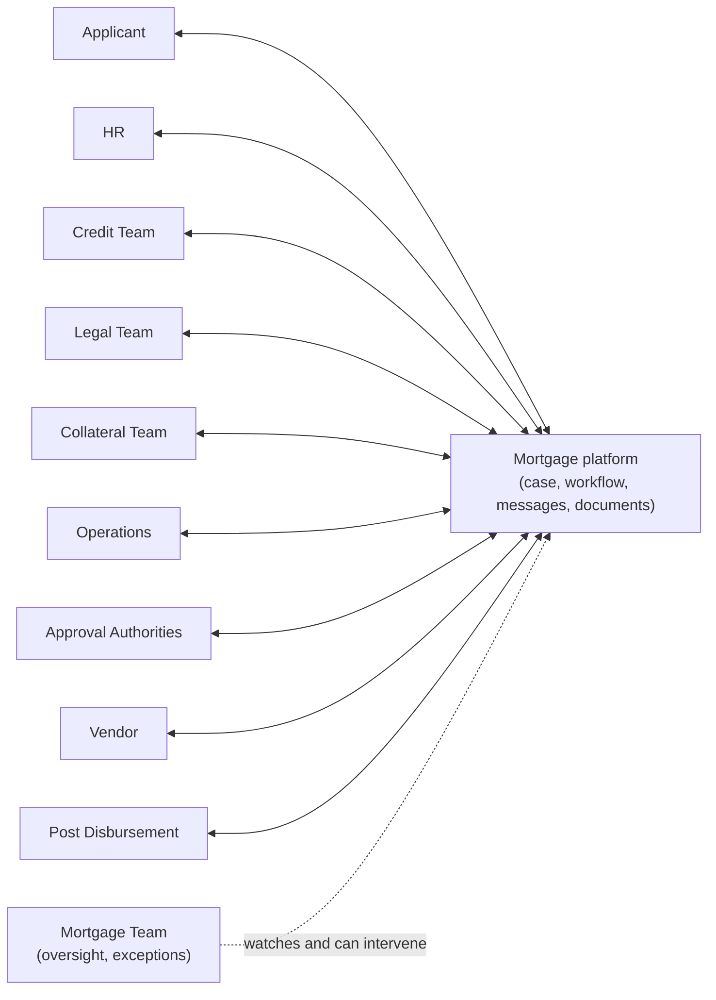
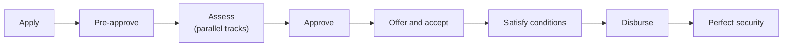

# 3. Future-State Operating Model and 4. Business Architecture

## 3.1 Design principles

1. **One case, one record.** Nothing lives in email, spreadsheets or paper.
2. **Direct contact, central record.** Stakeholders talk to each other inside the case, so every exchange is captured.
3. **Parallel by default.** A step waits only for what it truly depends on.
4. **Rules, not people, route work.** Routing, limits and escalation come from configuration.
5. **No disbursement until conditions are met.** The system enforces it.
6. **Staff privacy by design.** Applicants are colleagues, so access is need-to-know and conflict-checked.
7. **Humans decide adverse outcomes.** The system may auto-approve to pre-approval and refer; it never auto-declines.

## 3.2 Stakeholders and what they own

| Stakeholder | Owns in the future state | No longer does |
|---|---|---|
| Applicant | Completes forms, uploads documents, signs, pays fees, answers queries directly, tracks progress | Chase the Mortgage Team for status |
| HR | Employment and salary verification, HR approval, Director HR and DMD no-objection (by tier) | Receive paper from the Mortgage Team |
| Mortgage Team | Product ownership, case oversight, exception handling, pipeline management, offer pack quality | Relay documents and queries between units; prepare packages by hand |
| Credit Team | Affordability review, bureau result review, risk assessment, credit recommendation | Wait for a package compiled by the Mortgage Team |
| Approval Authorities | Approve within delegated limits | Chase files; approvals arrive in an inbox with the full case |
| Legal Team | Offer letter review, legal searches, mortgage deed, independent legal advice evidence | Run searches after approval only |
| Vendor | Provides property documents and due-diligence information through a secure vendor link | Send documents by email or courier |
| Collateral and Registration Team | Valuation management, property acceptance, fit-to-lend, security documentation, registration | Re-do the property assessment Credit already did |
| Credit Administration | Conditions-precedent verification, disbursement authorisation checks | Verify the same things in three separate steps |
| Operations | Fund release, vendor payment, mortgage account creation and activation | Receive instructions by email |
| Post Disbursement Team | Registration, perfection, Lands Commission, title, safe custody tracking | Work without due dates or alerts |

## 3.3 Interaction model

The brief's chain (Applicant, HR, Credit, Legal, Collateral, Operations) is a hub-and-spoke on the platform rather than a hand-off chain. Each unit sees the case and acts when its tasks open.

## 3.4 What "oversight only" means for the Mortgage Team

| Allowed | Not allowed |
|---|---|
| See every case, thread and task | Be a required recipient of every message |
| Join or comment on any thread | Hold a document until it is "forwarded" |
| Reassign a task, extend an SLA with a reason, escalate | Override an approval decision |
| Withdraw or put a case on hold with the applicant's agreement | Edit another unit's assessment |
| Raise a manual exception (decision D8) | Mark a condition satisfied on another unit's behalf |

## 4. Business architecture

### 4.1 Capability map

| Domain | Capabilities |
|---|---|
| **Customer** | Applicant portal, identity and staff verification, consent management, notifications, self-service tracking |
| **Origination** | Digital forms, application intake, duplicate checks, pre-approval, eligibility scoring |
| **Assessment** | HR verification, affordability, credit bureau, risk, credit recommendation |
| **Collateral** | Valuation management, legal searches, property acceptance, fit-to-lend, security documentation |
| **Decisioning** | Rules engine, approval matrix, delegation, escalation |
| **Fulfilment** | Offer generation, e-signature, conditions precedent, disbursement, account activation |
| **Servicing hand-off** | Post-disbursement tracking, registration and perfection, safe custody |
| **Enablers** | Case management, document management, communication centre, SLA engine, audit, reporting |

### 4.2 Value stream

### 4.3 RACI by stage

R = does the work, A = accountable, C = consulted, I = informed.

| Stage | Applicant | HR | Mortgage Team | Credit | Approvers | Legal | Collateral | Credit Admin | Operations | Post Disb. |
|---|---|---|---|---|---|---|---|---|---|---|
| Application and consent | R | I | A | | | | | | | |
| HR verification | C | R | I | | | | | | | |
| Pre-approval decision | I | C | A | R | | | | | | |
| Valuation | C | | I | I | | | R/A | | | |
| Legal searches | | | I | | | R/A | C | | | |
| Property acceptance | I | | I | C | | C | R/A | | | |
| Credit assessment | C | | I | R/A | | | C | | | |
| Approval | I | C | I | C | R/A | | | | | |
| Offer and acceptance | R | | A | | | C | | | | |
| Conditions precedent | R | | I | | | C | C | A | | |
| Security documentation | C | | I | | | R | A | C | | |
| Disbursement | I | | I | | C | | C | R | A | |
| Account activation | I | | I | | | | | C | R/A | |
| Post-disbursement perfection | I | | I | | | C | C | | | R/A |

### 4.4 Roles and access (summary)

Full RBAC is in [10](10-architecture-integration-security.md). The roles are: Applicant, Co-Borrower, Vendor, HR Officer, Director HR, DMD, Mortgage Officer, Mortgage Team Lead, Credit Analyst, Head Credit Evaluation, Legal Officer, Collateral Officer, Valuer (external), Credit Administrator, Operations Officer, Post Disbursement Officer, Head of Mortgage, Head Personal Banking, Executive Approver, Compliance and Audit (read-only), System Administrator.

### 4.5 Operating principles for the new model

- Each unit has a **task queue** with an SLA clock per task; the Mortgage Team sees all queues.
- Every **request for information** becomes a task for the applicant with a due date and a clock that pauses the case SLA while open.
- A unit **cannot close its stage** while it has unanswered requests it opened.
- A **case owner** is named at creation (a Mortgage Officer) and stays accountable for outcome and customer experience even though they no longer relay messages.
