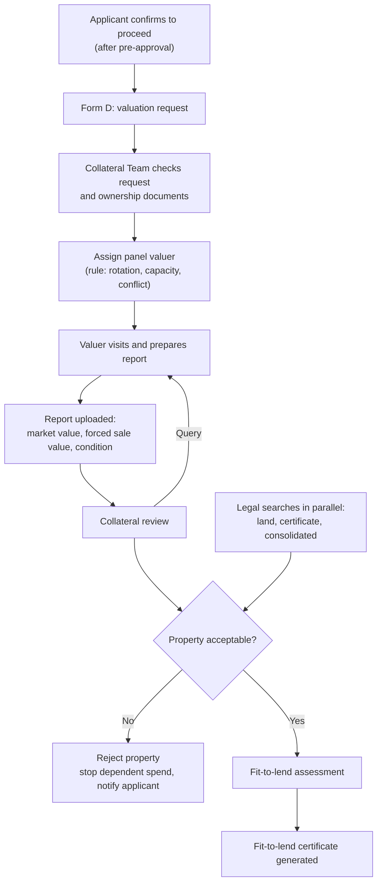
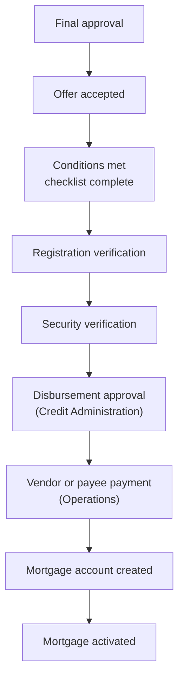

# Valuation and Collateral, Post-Approval Conditions, Disbursement, Post-Disbursement

Covers sections 11 to 14 of the brief.

## A. Valuation and collateral management

### A.1 Process

### A.2 Capabilities

| Capability | Design |
|---|---|
| Valuation request management | Form D creates a request with its own SLA clock and status: Requested, Assigned, Visit scheduled, Report received, Under review, Accepted, Rejected, Re-valuation requested. |
| Valuer assignment | Panel list with area, property types, capacity and conflict declarations. Rules propose a valuer; Collateral confirms. Valuer cannot be related to the vendor, developer or applicant. |
| SLA tracking | SLA-05 (assign) and SLA-06 (report). Delay notifies Collateral and, at breach, the Mortgage Team. |
| Report upload | Valuer signs in to a restricted portal, sees only their assignments, uploads the report and enters the structured fields. |
| Structured fields | Market value, forced sale value, valuation date, valuer firm and registration, property condition, occupancy, access, comparable evidence summary, remarks. |
| Review workflow | Collateral checks for completeness and reasonableness against price and comparables; may return to the valuer with queries. Second review required above a configured value. |
| Forced sale value | Taken from the report. Used in the equity release cap and in the collateral strength score. A system check flags FSV above market value or an FSV ratio outside a configured range. |
| Property acceptance decision | Collateral records Accept, Accept with conditions, or Reject with a reason code, after the valuation and legal search results are available. |
| Fit-to-lend certificate | Generated only when valuation accepted, searches clear and property accepted (BR-07). Contains property, owner, value, FSV, conditions. Valid for a configured period. |

### A.3 Legal searches

| Search | Purpose | Owner | Output |
|---|---|---|---|
| Land search | Confirms registered ownership and recorded encumbrances | Legal | Search report |
| Certificate search | Confirms the title certificate details | Legal | Search report |
| Consolidated search | Confirms the combined position | Legal | Search report |

Searches open in parallel at the same time as valuation. If the Lands Commission cannot be reached by integration, Legal records the manual result with the receipt attached (A5).

Result handling: each search is Clear, Clear with notes, or Adverse. Adverse results create a Collateral and Credit task and can lead to rejection. If property is rejected early, the system cancels dependent tasks and tells the applicant, which addresses pain point P6.

### A.4 Collateral review checklist

Title in correct name; no adverse encumbrance; site plan matches; building permit if applicable; valuation reasonable; FSV recorded; insurance arranged; vendor cleared (purchase); co-owner consent (equity release); property usable as security.

## B. Post-approval conditions

### B.1 Conditions precedent

| Condition | Home Purchase | Equity Release | Owner | Verifier | Evidence |
|---|---|---|---|---|---|
| Down payment proof | Yes | n/a | Applicant | Credit Admin | Bank evidence of payment to vendor or escrow |
| Spousal consent | If married | If married | Applicant | Legal | Signed consent |
| Independent legal advice | Yes | Yes | Applicant | Legal | Certificate from the applicant's own lawyer |
| Statutory declaration | Yes | Yes | Applicant | Legal | Sworn declaration |
| Insurance policies | Yes | Yes | Applicant | Credit Admin | Property and mortgage protection, bank noted as interested party |
| Registration fees | Yes | Yes | Applicant | Collateral | Payment receipt |
| Property inspection | Yes (and per stage) | Yes (renovation stages) | Collateral | Collateral Lead | Inspection report |
| Fit-to-lend certificate | Yes | Yes | Collateral | Credit Admin | Certificate in the case |
| Mortgage documentation signed | Yes | Yes | Applicant | Legal | Executed documents |
| Existing lender consent | n/a | If prior charge | Applicant | Legal | Consent letter |
| Vendor cleared | If private vendor | n/a | Legal | Credit | Due diligence outcome |
| Approval conditions | As set | As set | As set | Credit Admin | As set |

The list is a template per product and is editable in configuration (NFR-11). Approvers can add conditions during approval.

### B.2 Condition lifecycle

Open → Evidence submitted → Verified, or Rejected (with reason, back to Open), or Waived (needs approver at or above the level that approved the case, with a reason). Disbursement is blocked until every mandatory condition is Verified or Waived (BR-10).

## C. Disbursement management

### C.1 Disbursement gate

The request can be created only if all of these pass automatically:

1. Case state is Offer Accepted.
2. Every mandatory condition is Verified or Waived.
3. Fit-to-lend certificate valid.
4. Mortgage documents executed.
5. Registration fee paid and registration documents lodged or evidenced.
6. Security verification complete (documents, authorities, security: the three checks that exist in the AS-IS Credit Admin lane, now ticks on one checklist).
7. Payee verified: vendor cleared (purchase), or payee account validated (equity release).
8. Disbursement amount does not exceed approved amount, and stage amount does not exceed the progress certificate.

### C.2 Steps and ownership

| Step | Owner | System behaviour |
|---|---|---|
| Registration verification | Collateral | Confirms registration items evidenced |
| Security verification | Credit Administration | One checklist replaces three sequential verifications |
| Disbursement approval | Credit Administration (and approver by amount if the matrix requires) | Four-eyes check; preparer cannot approve |
| Payment | Operations | Instruction to core banking with idempotency key; payee name matched to account |
| Account creation | Operations | Account created with schedule, rate, tenor |
| Activation | Operations | Activation recorded; applicant notified |

### C.3 Staged disbursement

Under-construction purchases and renovation releases disburse in tranches. Each tranche needs a progress certificate or inspection report, the cumulative amount stays within the approved amount, and each tranche passes the same gate.

### C.4 Equity release payees

| Purpose | Default payee |
|---|---|
| Tuition payments | The school or university |
| Medical expenses | The hospital or provider, or the applicant against an invoice |
| Home improvement or renovation | Contractor, in stages |
| Family emergency | Applicant's account |

Exceptions go to Credit with a reason.

## D. Post-disbursement management

### D.1 Tracked items

| Item | Owner | Proposed due after disbursement | Evidence |
|---|---|---|---|
| Mortgage registration | Post Disbursement with Legal | 30 days | Lodgement receipt |
| Security perfection | Post Disbursement with Legal | 60 days | Perfected security evidence |
| Lands Commission registration | Post Disbursement | 90 days | Registration acknowledgment |
| Title perfection | Post Disbursement | 120 days | Registered title in bank's favour |
| Safe custody | Post Disbursement | On receipt of originals | Custody register entry and location |

Due periods are configuration and the figures are proposals to confirm with Legal.

### D.2 Alerts

| Alert | When | To |
|---|---|---|
| Due soon | 14 days and 7 days before | Item owner |
| Overdue | Day after due | Owner, supervisor, Mortgage Team |
| Seriously overdue | 30 days past due | Head of Mortgage, Head of Legal |
| Missing original documents | On case closure attempt | Owner |
| Insurance expiring | 60 days before expiry | Applicant, Credit Admin |

### D.3 Closure

The case closes when all items are closed or waived with approval and originals are in safe custody. The post-disbursement dashboard ([12](12-dashboards.md)) shows ageing by item and by owner.
