# 15. Combined Data Model (ERD) and 16. Database Schema

## 15.1 Design notes

- `mortgage_application` is the case root. Every other case table has `application_id`.
- Product-specific data sits in `home_purchase_details` and `equity_release_details`, one row per application at most.
- Documents are versioned; messages and audit rows are append-only.
- Configuration (products, rule parameters, SLA policy, approval matrix) is data, versioned with effective dates.
- Primary keys are UUIDs. Money is `NUMERIC(18,2)`. Times are `TIMESTAMPTZ` in UTC.
- The schema is PostgreSQL-flavoured; adapt types if Advance Flow stores data elsewhere.

## 15.2 Entity relationship diagram

```mermaid
erDiagram
  APPLICANT ||--o{ MORTGAGE_APPLICATION : "submits"
  APPLICANT ||--o{ CO_BORROWER : "invites"
  MORTGAGE_PRODUCT ||--o{ MORTGAGE_APPLICATION : "defines"
  MORTGAGE_APPLICATION ||--o| HOME_PURCHASE_DETAILS : "has"
  MORTGAGE_APPLICATION ||--o| EQUITY_RELEASE_DETAILS : "has"
  MORTGAGE_APPLICATION }o--|| PROPERTY : "secured by"
  PROPERTY ||--o{ VALUATION_REQUEST : "valued through"
  VALUATION_REQUEST ||--o| VALUATION_REPORT : "produces"
  VALUER ||--o{ VALUATION_REQUEST : "assigned"
  PROPERTY ||--o{ LEGAL_SEARCH : "searched"
  MORTGAGE_APPLICATION ||--o{ CONSENT : "records"
  MORTGAGE_APPLICATION ||--o| HR_VERIFICATION : "verified by"
  MORTGAGE_APPLICATION ||--o{ FINANCIAL_ASSESSMENT : "assessed in"
  MORTGAGE_APPLICATION ||--o{ ASSET_LIABILITY : "declares"
  MORTGAGE_APPLICATION ||--o{ CREDIT_ASSESSMENT : "reviewed in"
  MORTGAGE_APPLICATION ||--o| PRE_APPROVAL : "decided by"
  MORTGAGE_APPLICATION ||--o{ COLLATERAL_ASSESSMENT : "assessed for"
  COLLATERAL_ASSESSMENT ||--o| FIT_TO_LEND : "may issue"
  MORTGAGE_APPLICATION ||--o{ APPROVAL : "approved by"
  MORTGAGE_APPLICATION ||--o{ OFFER_LETTER : "offers"
  MORTGAGE_APPLICATION ||--o{ CONDITION_PRECEDENT : "requires"
  MORTGAGE_APPLICATION ||--o{ SECURITY_DOCUMENT : "secured with"
  MORTGAGE_APPLICATION ||--o{ DISBURSEMENT : "funded by"
  MORTGAGE_APPLICATION ||--o| MORTGAGE_ACCOUNT : "becomes"
  MORTGAGE_ACCOUNT ||--o{ POST_DISBURSEMENT : "tracked by"
  VENDOR ||--o{ HOME_PURCHASE_DETAILS : "sells under"
  VENDOR ||--o{ VENDOR_DUE_DILIGENCE : "checked by"
  MORTGAGE_APPLICATION ||--o{ DOCUMENT : "holds"
  DOCUMENT ||--o{ DOCUMENT_VERSION : "versioned as"
  MORTGAGE_APPLICATION ||--o{ COMM_THREAD : "discussed in"
  COMM_THREAD ||--o{ COMMUNICATION : "contains"
  MORTGAGE_APPLICATION ||--o{ TASK : "generates"
  MORTGAGE_APPLICATION ||--o{ WORKFLOW_HISTORY : "logs"
  MORTGAGE_APPLICATION ||--o{ AUDIT_LOG : "audited by"
  MORTGAGE_APPLICATION ||--o{ NOTIFICATION : "notifies"
  APPROVAL_RULE ||--o{ APPROVAL : "routes"
```



Key attributes per entity are in the schema below.

## 15.3 Entities, keys and relationships

| Entity | Primary key | Foreign keys | Notes |
|---|---|---|---|
| Applicant | applicant_id | | One per staff member, loaded from HR |
| MortgageApplication | application_id | applicant_id, product_id, property_id | Case root |
| MortgageProduct | product_id | | Home Purchase, Equity Release; versioned |
| Property | property_id | | Title number unique among active cases |
| HomePurchaseDetails | application_id | vendor_id | One per application |
| EquityReleaseDetails | application_id | | One per application |
| HRVerification | hr_verification_id | application_id, verified_by | |
| FinancialAssessment | assessment_id | application_id | Versioned on each recalculation |
| CreditAssessment | credit_assessment_id | application_id | Bureau result and recommendation |
| ValuationRequest | valuation_request_id | application_id, property_id, valuer_id | |
| ValuationReport | valuation_report_id | valuation_request_id | |
| LegalSearch | legal_search_id | application_id, property_id | Land, certificate, consolidated |
| CollateralAssessment | collateral_assessment_id | application_id, valuation_report_id | Property acceptance |
| FitToLend | fit_to_lend_id | collateral_assessment_id | |
| Approval | approval_id | application_id, rule_id | One per level |
| ConditionPrecedent | condition_id | application_id | |
| Document | document_id | application_id | Versions in DocumentVersion |
| Communication | message_id | thread_id | Append-only |
| Task | task_id | application_id | |
| WorkflowHistory | history_id | application_id | Append-only |
| OfferLetter | offer_id | application_id | |
| SecurityDocument | security_document_id | application_id | |
| Disbursement | disbursement_id | application_id | One per tranche |
| MortgageAccount | account_id | application_id | |
| PostDisbursement | item_id | account_id | |

## 15.4 Business rules enforced in the model

| ID | Rule | Enforced by |
|---|---|---|
| DM-01 | One active application per employee per product | Partial unique index |
| DM-02 | One title number in at most one active application | Partial unique index |
| DM-03 | Equity release amount at most 70% of FSV less existing balance | Trigger and service rule |
| DM-04 | Down payment at least 20% of price in purchases | Check in `home_purchase_details` |
| DM-05 | Fit-to-lend requires accepted collateral assessment | Trigger and service rule |
| DM-06 | Disbursement requires no open mandatory conditions | Service rule and database trigger |
| DM-07 | Audit, workflow history and messages cannot be updated or deleted | Database privileges and trigger |
| DM-08 | Consent text version stored with each consent | NOT NULL `text_version` |
| DM-09 | A person cannot approve their own case | Service rule and check on `approval.approver_id <> applicant staff` |
| DM-10 | Sum of disbursements at most approved amount | Trigger |

## 16. Database schema

```sql
-- ===== Reference and configuration =====
CREATE TABLE mortgage_product (
  product_id        UUID PRIMARY KEY,
  code              TEXT NOT NULL,             -- HOME_PURCHASE, EQUITY_RELEASE
  name              TEXT NOT NULL,
  version           INT  NOT NULL,
  effective_from    DATE NOT NULL,
  effective_to      DATE,
  max_ltv_pct       NUMERIC(5,2),
  max_fsv_pct       NUMERIC(5,2),
  min_down_pct      NUMERIC(5,2),
  max_tenor_years   INT NOT NULL,
  max_dsr_pct       NUMERIC(5,2) NOT NULL,
  UNIQUE (code, version)
);

CREATE TABLE rule_parameter (
  parameter_id   UUID PRIMARY KEY,
  product_id     UUID REFERENCES mortgage_product,
  name           TEXT NOT NULL,
  param_value    TEXT NOT NULL,
  effective_from DATE NOT NULL,
  effective_to   DATE,
  changed_by     TEXT NOT NULL
);

CREATE TABLE sla_policy (
  sla_id          UUID PRIMARY KEY,
  code            TEXT NOT NULL,               -- SLA-01 ...
  task_type       TEXT NOT NULL,
  target_minutes  INT  NOT NULL,
  clock_type      TEXT NOT NULL CHECK (clock_type IN ('ELAPSED','BUSINESS')),
  pauses_on_applicant BOOLEAN NOT NULL DEFAULT TRUE,
  warn_pct        INT NOT NULL DEFAULT 75,
  escalate_pct    INT NOT NULL DEFAULT 150
);

CREATE TABLE approval_rule (
  rule_id        UUID PRIMARY KEY,
  tier           TEXT NOT NULL,                -- T1..T4
  min_amount     NUMERIC(18,2) NOT NULL,
  max_amount     NUMERIC(18,2),
  level_code     TEXT NOT NULL,                -- L1..L8
  parallel_group INT NOT NULL,
  per_case_limit NUMERIC(18,2),
  effective_from DATE NOT NULL,
  effective_to   DATE
);

-- ===== Parties =====
CREATE TABLE applicant (
  applicant_id      UUID PRIMARY KEY,
  employee_no       TEXT NOT NULL UNIQUE,
  staff_id          TEXT NOT NULL,
  full_name         TEXT NOT NULL,
  department        TEXT NOT NULL,
  branch            TEXT NOT NULL,
  job_title         TEXT NOT NULL,
  employment_status TEXT NOT NULL,
  date_employed     DATE NOT NULL,
  retirement_date   DATE NOT NULL,
  date_of_birth     DATE NOT NULL,
  national_id_enc   BYTEA NOT NULL,            -- field-level encryption
  national_id_hash  TEXT  NOT NULL,            -- for duplicate lookup
  phone             TEXT NOT NULL,
  email             TEXT NOT NULL,
  address           TEXT NOT NULL,
  marital_status    TEXT NOT NULL,
  hr_synced_at      TIMESTAMPTZ
);

CREATE TABLE co_borrower (
  co_borrower_id    UUID PRIMARY KEY,
  application_id    UUID NOT NULL,
  full_name         TEXT NOT NULL,
  relationship      TEXT NOT NULL,
  national_id_enc   BYTEA NOT NULL,
  date_of_birth     DATE NOT NULL,
  phone             TEXT NOT NULL,
  email             TEXT,
  occupation        TEXT,
  employer          TEXT,
  net_monthly_income NUMERIC(18,2),
  identity_verified BOOLEAN NOT NULL DEFAULT FALSE
);

CREATE TABLE vendor (
  vendor_id      UUID PRIMARY KEY,
  vendor_type    TEXT NOT NULL CHECK (vendor_type IN ('DEVELOPER','PRIVATE')),
  name           TEXT NOT NULL,
  contact_person TEXT,
  email          TEXT,
  phone          TEXT,
  address        TEXT,
  bank_account_name TEXT,
  bank_account_no_enc BYTEA,
  cleared_status TEXT NOT NULL DEFAULT 'PENDING'
                 CHECK (cleared_status IN ('PENDING','CLEARED','CLEARED_WITH_CONDITIONS','NOT_CLEARED'))
);

CREATE TABLE vendor_due_diligence (
  dd_id          UUID PRIMARY KEY,
  vendor_id      UUID NOT NULL REFERENCES vendor,
  application_id UUID NOT NULL,
  ghana_card_enc BYTEA,
  company_name   TEXT,
  registration_no TEXT,
  authority_to_sell_doc UUID,
  reviewed_by    TEXT,
  outcome        TEXT,
  reviewed_at    TIMESTAMPTZ
);

CREATE TABLE valuer (
  valuer_id      UUID PRIMARY KEY,
  firm_name      TEXT NOT NULL,
  registration_no TEXT NOT NULL,
  areas          TEXT[] NOT NULL,
  property_types TEXT[] NOT NULL,
  max_open_jobs  INT NOT NULL DEFAULT 10,
  active         BOOLEAN NOT NULL DEFAULT TRUE
);

-- ===== Property =====
CREATE TABLE property (
  property_id        UUID PRIMARY KEY,
  title_number       TEXT NOT NULL,
  registration_no    TEXT,
  site_plan_ref      TEXT,
  address            TEXT NOT NULL,
  digital_address    TEXT,
  property_type      TEXT NOT NULL,
  description        TEXT,
  construction_status TEXT NOT NULL CHECK (construction_status IN ('COMPLETED','UNDER_CONSTRUCTION','OFF_PLAN')),
  ownership_type     TEXT NOT NULL CHECK (ownership_type IN ('FREEHOLD','LEASEHOLD')),
  lease_years_remaining INT,
  registered_owner   TEXT,
  location_region    TEXT,
  location_area      TEXT
);

-- ===== Application (case root) =====
CREATE TABLE mortgage_application (
  application_id   UUID PRIMARY KEY,
  reference_no     TEXT UNIQUE,                -- MTG-yyyy-nnnnnn, set on submit
  applicant_id     UUID NOT NULL REFERENCES applicant,
  product_id       UUID NOT NULL REFERENCES mortgage_product,
  property_id      UUID REFERENCES property,
  state            TEXT NOT NULL,              -- see case states
  currency         CHAR(3) NOT NULL DEFAULT 'GHS',
  requested_amount NUMERIC(18,2),
  approved_amount  NUMERIC(18,2),
  tenor_months     INT,
  interest_rate_pct NUMERIC(6,3),
  owner_user_id    TEXT,                       -- accountable Mortgage Officer
  current_stage    TEXT,
  created_at       TIMESTAMPTZ NOT NULL DEFAULT now(),
  submitted_at     TIMESTAMPTZ,
  closed_at        TIMESTAMPTZ,
  locked           BOOLEAN NOT NULL DEFAULT FALSE,
  form_versions    JSONB
);
-- DM-01: one active application per employee per product
CREATE UNIQUE INDEX uq_active_app ON mortgage_application (applicant_id, product_id)
  WHERE state NOT IN ('CLOSED','WITHDRAWN','DECLINED','EXPIRED');
-- DM-02: one title in one active application
CREATE UNIQUE INDEX uq_active_title ON mortgage_application (property_id)
  WHERE state NOT IN ('CLOSED','WITHDRAWN','DECLINED','EXPIRED') AND property_id IS NOT NULL;

ALTER TABLE co_borrower ADD FOREIGN KEY (application_id) REFERENCES mortgage_application;
ALTER TABLE vendor_due_diligence ADD FOREIGN KEY (application_id) REFERENCES mortgage_application;

CREATE TABLE home_purchase_details (
  application_id  UUID PRIMARY KEY REFERENCES mortgage_application,
  vendor_id       UUID REFERENCES vendor,
  purpose         TEXT NOT NULL,
  purchase_price  NUMERIC(18,2) NOT NULL,
  property_value  NUMERIC(18,2) NOT NULL,
  down_payment    NUMERIC(18,2) NOT NULL,
  ltv_pct         NUMERIC(6,2),
  CONSTRAINT ck_down CHECK (down_payment >= 0.20 * purchase_price),   -- DM-04
  CONSTRAINT ck_amt  CHECK (down_payment < purchase_price)
);

CREATE TABLE equity_release_details (
  application_id   UUID PRIMARY KEY REFERENCES mortgage_application,
  declared_value   NUMERIC(18,2) NOT NULL,
  forced_sale_value NUMERIC(18,2),
  existing_mortgage_status TEXT NOT NULL CHECK (existing_mortgage_status IN ('NONE','THIS_BANK','OTHER_LENDER')),
  existing_mortgage_balance NUMERIC(18,2) NOT NULL DEFAULT 0,
  existing_lender  TEXT,
  ownership_status TEXT NOT NULL CHECK (ownership_status IN ('SOLE','JOINT')),
  purpose          TEXT NOT NULL CHECK (purpose IN ('HOME_IMPROVEMENT','HOME_RENOVATION','MEDICAL','FAMILY_EMERGENCY','TUITION')),
  reason           TEXT,
  justification    TEXT,
  max_release      NUMERIC(18,2),               -- computed: 0.70*FSV - existing balance, floor 0
  payee_name       TEXT,
  payee_account_enc BYTEA
);

-- ===== Consent, verification, assessment =====
CREATE TABLE consent (
  consent_id     UUID PRIMARY KEY,
  application_id UUID NOT NULL REFERENCES mortgage_application,
  signer_type    TEXT NOT NULL CHECK (signer_type IN ('APPLICANT','CO_BORROWER')),
  consent_type   TEXT NOT NULL CHECK (consent_type IN ('CREDIT_BUREAU','IDENTITY','DATA_PROCESSING','REGULATORY','INFO_SHARING')),
  accepted       BOOLEAN NOT NULL,
  text_version   TEXT NOT NULL,                 -- DM-08
  text_hash      TEXT NOT NULL,
  signed_at      TIMESTAMPTZ NOT NULL,
  signature_ref  TEXT NOT NULL,
  ip_address     INET,
  device         TEXT,
  withdrawn_at   TIMESTAMPTZ
);

CREATE TABLE hr_verification (
  hr_verification_id UUID PRIMARY KEY,
  application_id  UUID NOT NULL UNIQUE REFERENCES mortgage_application,
  employment_confirmed BOOLEAN,
  salary_confirmed     NUMERIC(18,2),
  discrepancies   JSONB,
  verified_by     TEXT,
  verified_at     TIMESTAMPTZ
);

CREATE TABLE financial_assessment (
  assessment_id   UUID PRIMARY KEY,
  application_id  UUID NOT NULL REFERENCES mortgage_application,
  version         INT  NOT NULL,
  basic_salary    NUMERIC(18,2) NOT NULL,
  allowances      NUMERIC(18,2) NOT NULL DEFAULT 0,
  other_income    NUMERIC(18,2) NOT NULL DEFAULT 0,
  deductions      NUMERIC(18,2) NOT NULL DEFAULT 0,
  existing_obligations NUMERIC(18,2) NOT NULL DEFAULT 0,
  proposed_instalment  NUMERIC(18,2),
  gross_income    NUMERIC(18,2),
  net_income      NUMERIC(18,2),
  disposable_income NUMERIC(18,2),
  dsr_pct         NUMERIC(6,2),
  dti_pct         NUMERIC(6,2),
  affordability_score NUMERIC(5,2),
  max_instalment  NUMERIC(18,2),
  eligible_amount NUMERIC(18,2),
  calculated_at   TIMESTAMPTZ NOT NULL DEFAULT now(),
  UNIQUE (application_id, version)
);

CREATE TABLE asset_liability (
  item_id        UUID PRIMARY KEY,
  application_id UUID NOT NULL REFERENCES mortgage_application,
  kind           TEXT NOT NULL CHECK (kind IN ('ASSET','LIABILITY')),
  category       TEXT NOT NULL,                 -- SAVINGS, INVESTMENT, VEHICLE, REAL_ESTATE, MORTGAGE, SALARY_LOAN, CAR_LOAN, PERSONAL_LOAN
  description    TEXT,
  lender         TEXT,
  value_or_balance NUMERIC(18,2) NOT NULL,
  monthly_payment  NUMERIC(18,2)
);

CREATE TABLE credit_assessment (
  credit_assessment_id UUID PRIMARY KEY,
  application_id  UUID NOT NULL REFERENCES mortgage_application,
  bureau_reference TEXT,
  bureau_score    INT,
  bureau_report_doc UUID,
  bureau_requested_at TIMESTAMPTZ,
  risk_grade      TEXT,
  recommendation  TEXT CHECK (recommendation IN ('RECOMMEND','RECOMMEND_WITH_CONDITIONS','DO_NOT_RECOMMEND')),
  reasons         TEXT,
  net_worth       NUMERIC(18,2),
  exposure_ratio  NUMERIC(8,3),
  analyst_id      TEXT,
  completed_at    TIMESTAMPTZ
);

CREATE TABLE pre_approval (
  application_id  UUID PRIMARY KEY REFERENCES mortgage_application,
  eligibility_score NUMERIC(5,2) NOT NULL,
  decision        TEXT NOT NULL CHECK (decision IN ('PRE_APPROVED','REFERRED','NOT_ELIGIBLE_AS_SUBMITTED')),
  hard_stops      JSONB,
  eligible_amount NUMERIC(18,2),
  valid_until     DATE,
  decided_at      TIMESTAMPTZ NOT NULL,
  decided_by      TEXT NOT NULL                 -- 'SYSTEM' or a user
);

-- ===== Valuation, legal, collateral =====
CREATE TABLE valuation_request (
  valuation_request_id UUID PRIMARY KEY,
  application_id  UUID NOT NULL REFERENCES mortgage_application,
  property_id     UUID NOT NULL REFERENCES property,
  valuer_id       UUID REFERENCES valuer,
  contact_person  TEXT NOT NULL,
  contact_number  TEXT NOT NULL,
  property_owner  TEXT NOT NULL,
  status          TEXT NOT NULL,
  requested_at    TIMESTAMPTZ NOT NULL DEFAULT now(),
  assigned_at     TIMESTAMPTZ,
  due_at          TIMESTAMPTZ
);

CREATE TABLE valuation_report (
  valuation_report_id UUID PRIMARY KEY,
  valuation_request_id UUID NOT NULL UNIQUE REFERENCES valuation_request,
  market_value    NUMERIC(18,2) NOT NULL,
  forced_sale_value NUMERIC(18,2) NOT NULL,
  valuation_date  DATE NOT NULL,
  property_condition TEXT,
  occupancy       TEXT,
  report_doc_id   UUID NOT NULL,
  reviewed_by     TEXT,
  review_outcome  TEXT,
  CONSTRAINT ck_fsv CHECK (forced_sale_value <= market_value)
);

CREATE TABLE legal_search (
  legal_search_id UUID PRIMARY KEY,
  application_id  UUID NOT NULL REFERENCES mortgage_application,
  property_id     UUID NOT NULL REFERENCES property,
  search_type     TEXT NOT NULL CHECK (search_type IN ('LAND','CERTIFICATE','CONSOLIDATED')),
  status          TEXT NOT NULL,
  result          TEXT CHECK (result IN ('CLEAR','CLEAR_WITH_NOTES','ADVERSE')),
  notes           TEXT,
  report_doc_id   UUID,
  requested_at    TIMESTAMPTZ,
  completed_at    TIMESTAMPTZ
);

CREATE TABLE collateral_assessment (
  collateral_assessment_id UUID PRIMARY KEY,
  application_id  UUID NOT NULL REFERENCES mortgage_application,
  valuation_report_id UUID REFERENCES valuation_report,
  decision        TEXT NOT NULL CHECK (decision IN ('ACCEPT','ACCEPT_WITH_CONDITIONS','REJECT')),
  reason_code     TEXT,
  checklist       JSONB,
  assessed_by     TEXT NOT NULL,
  assessed_at     TIMESTAMPTZ NOT NULL
);

CREATE TABLE fit_to_lend (
  fit_to_lend_id  UUID PRIMARY KEY,
  collateral_assessment_id UUID NOT NULL UNIQUE REFERENCES collateral_assessment,
  certificate_doc_id UUID NOT NULL,
  issued_at       TIMESTAMPTZ NOT NULL,
  valid_until     DATE NOT NULL,
  conditions      TEXT
);

-- ===== Decision, offer, security =====
CREATE TABLE approval (
  approval_id     UUID PRIMARY KEY,
  application_id  UUID NOT NULL REFERENCES mortgage_application,
  rule_id         UUID NOT NULL REFERENCES approval_rule,
  level_code      TEXT NOT NULL,
  approver_id     TEXT NOT NULL,
  on_behalf_of    TEXT,
  decision        TEXT CHECK (decision IN ('APPROVE','APPROVE_WITH_CONDITIONS','RETURN','DECLINE')),
  reason_code     TEXT,
  approver_comment TEXT,
  exception_flag  BOOLEAN NOT NULL DEFAULT FALSE,
  assigned_at     TIMESTAMPTZ NOT NULL,
  decided_at      TIMESTAMPTZ,
  matrix_version  TEXT NOT NULL
);

CREATE TABLE offer_letter (
  offer_id        UUID PRIMARY KEY,
  application_id  UUID NOT NULL REFERENCES mortgage_application,
  amount          NUMERIC(18,2) NOT NULL,
  tenor_months    INT NOT NULL,
  rate_pct        NUMERIC(6,3) NOT NULL,
  instalment      NUMERIC(18,2) NOT NULL,
  issued_at       TIMESTAMPTZ NOT NULL,
  valid_until     DATE NOT NULL,
  til_doc_id      UUID,
  offer_doc_id    UUID NOT NULL,
  accepted_at     TIMESTAMPTZ,
  signature_ref   TEXT
);

CREATE TABLE condition_precedent (
  condition_id    UUID PRIMARY KEY,
  application_id  UUID NOT NULL REFERENCES mortgage_application,
  code            TEXT NOT NULL,
  description     TEXT NOT NULL,
  mandatory       BOOLEAN NOT NULL DEFAULT TRUE,
  owner_role      TEXT NOT NULL,
  verifier_role   TEXT NOT NULL,
  due_date        DATE,
  status          TEXT NOT NULL CHECK (status IN ('OPEN','EVIDENCE_SUBMITTED','VERIFIED','REJECTED','WAIVED')),
  evidence_doc_id UUID,
  verified_by     TEXT,
  verified_at     TIMESTAMPTZ,
  waived_by       TEXT,
  waiver_reason   TEXT
);

CREATE TABLE security_document (
  security_document_id UUID PRIMARY KEY,
  application_id  UUID NOT NULL REFERENCES mortgage_application,
  doc_type        TEXT NOT NULL,                -- MORTGAGE_DEED, POWER_OF_ATTORNEY, CONSENT, ...
  document_id     UUID NOT NULL,
  prepared_by     TEXT,
  executed_at     TIMESTAMPTZ,
  original_location TEXT
);

-- ===== Disbursement and after =====
CREATE TABLE disbursement (
  disbursement_id UUID PRIMARY KEY,
  application_id  UUID NOT NULL REFERENCES mortgage_application,
  tranche_no      INT NOT NULL DEFAULT 1,
  payee_name      TEXT NOT NULL,
  payee_account_enc BYTEA NOT NULL,
  amount          NUMERIC(18,2) NOT NULL CHECK (amount > 0),
  progress_certificate_doc UUID,
  status          TEXT NOT NULL,
  requested_by    TEXT NOT NULL,
  approved_by     TEXT,
  approved_at     TIMESTAMPTZ,
  paid_at         TIMESTAMPTZ,
  payment_ref     TEXT,
  UNIQUE (application_id, tranche_no),
  CHECK (approved_by IS NULL OR approved_by <> requested_by)   -- four eyes
);

CREATE TABLE mortgage_account (
  account_id      UUID PRIMARY KEY,
  application_id  UUID NOT NULL UNIQUE REFERENCES mortgage_application,
  core_account_no TEXT NOT NULL UNIQUE,
  opened_at       TIMESTAMPTZ NOT NULL,
  activated_at    TIMESTAMPTZ,
  principal       NUMERIC(18,2) NOT NULL,
  rate_pct        NUMERIC(6,3) NOT NULL,
  tenor_months    INT NOT NULL
);

CREATE TABLE post_disbursement (
  item_id         UUID PRIMARY KEY,
  account_id      UUID NOT NULL REFERENCES mortgage_account,
  item_type       TEXT NOT NULL CHECK (item_type IN ('MORTGAGE_REGISTRATION','SECURITY_PERFECTION','LANDS_COMMISSION','TITLE_PERFECTION','SAFE_CUSTODY')),
  owner_user_id   TEXT,
  due_date        DATE NOT NULL,
  status          TEXT NOT NULL CHECK (status IN ('OPEN','IN_PROGRESS','DONE','WAIVED')),
  evidence_doc_id UUID,
  completed_at    TIMESTAMPTZ,
  waiver_reason   TEXT
);

-- ===== Documents =====
CREATE TABLE document (
  document_id     UUID PRIMARY KEY,
  application_id  UUID NOT NULL REFERENCES mortgage_application,
  category        TEXT NOT NULL,                -- APPLICATION_FORM, CONSENT, PROPERTY, CREDIT, LEGAL, COLLATERAL, INSURANCE, REGISTRATION, DISBURSEMENT
  doc_type        TEXT NOT NULL,                -- NATIONAL_ID, PAYSLIP, ...
  classification  TEXT NOT NULL CHECK (classification IN ('PUBLIC','INTERNAL','CONFIDENTIAL','RESTRICTED')),
  retention_class TEXT NOT NULL,
  current_version INT NOT NULL DEFAULT 1,
  created_by      TEXT NOT NULL,
  created_at      TIMESTAMPTZ NOT NULL DEFAULT now()
);

CREATE TABLE document_version (
  document_id     UUID NOT NULL REFERENCES document,
  version         INT  NOT NULL,
  storage_key     TEXT NOT NULL,
  file_name       TEXT NOT NULL,
  mime_type       TEXT NOT NULL,
  size_bytes      BIGINT NOT NULL,
  sha256          TEXT NOT NULL,
  ocr_text        TEXT,
  ocr_fields      JSONB,
  metadata        JSONB,
  uploaded_by     TEXT NOT NULL,
  uploaded_at     TIMESTAMPTZ NOT NULL DEFAULT now(),
  PRIMARY KEY (document_id, version)
);

-- ===== Collaboration and control =====
CREATE TABLE comm_thread (
  thread_id       UUID PRIMARY KEY,
  application_id  UUID NOT NULL REFERENCES mortgage_application,
  topic           TEXT NOT NULL,                -- HR, CREDIT, LEGAL, COLLATERAL, OPERATIONS, VENDOR, GENERAL
  visibility      TEXT NOT NULL CHECK (visibility IN ('WITH_APPLICANT','INTERNAL')),
  created_at      TIMESTAMPTZ NOT NULL DEFAULT now()
);

CREATE TABLE communication (
  message_id      UUID PRIMARY KEY,
  thread_id       UUID NOT NULL REFERENCES comm_thread,
  sender_id       TEXT NOT NULL,
  sender_role     TEXT NOT NULL,
  kind            TEXT NOT NULL CHECK (kind IN ('MESSAGE','REQUEST','NOTE','SYSTEM')),
  body            TEXT NOT NULL,
  attachment_doc_ids UUID[],
  request_task_id UUID,
  sent_at         TIMESTAMPTZ NOT NULL DEFAULT now(),
  edited_at       TIMESTAMPTZ
);

CREATE TABLE task (
  task_id         UUID PRIMARY KEY,
  application_id  UUID NOT NULL REFERENCES mortgage_application,
  task_type       TEXT NOT NULL,
  owner_team      TEXT NOT NULL,
  assignee_id     TEXT,
  sla_id          UUID REFERENCES sla_policy,
  status          TEXT NOT NULL CHECK (status IN ('OPEN','IN_PROGRESS','WAITING_APPLICANT','DONE','CANCELLED')),
  outcome         TEXT,
  created_at      TIMESTAMPTZ NOT NULL DEFAULT now(),
  due_at          TIMESTAMPTZ,
  paused_minutes  INT NOT NULL DEFAULT 0,
  completed_at    TIMESTAMPTZ,
  escalation_level INT NOT NULL DEFAULT 0
);

CREATE TABLE workflow_history (
  history_id      BIGSERIAL PRIMARY KEY,
  application_id  UUID NOT NULL REFERENCES mortgage_application,
  from_state      TEXT,
  to_state        TEXT NOT NULL,
  actor_id        TEXT NOT NULL,
  reason          TEXT,
  occurred_at     TIMESTAMPTZ NOT NULL DEFAULT now()
);

CREATE TABLE notification (
  notification_id UUID PRIMARY KEY,
  application_id  UUID NOT NULL REFERENCES mortgage_application,
  recipient       TEXT NOT NULL,
  channel         TEXT NOT NULL CHECK (channel IN ('IN_APP','EMAIL','SMS')),
  template_code   TEXT NOT NULL,
  body            TEXT NOT NULL,
  status          TEXT NOT NULL,
  sent_at         TIMESTAMPTZ,
  provider_ref    TEXT
);

CREATE TABLE audit_log (
  audit_id        BIGSERIAL PRIMARY KEY,
  application_id  UUID,
  occurred_at     TIMESTAMPTZ NOT NULL DEFAULT now(),
  actor_id        TEXT NOT NULL,
  actor_role      TEXT,
  action          TEXT NOT NULL,
  entity          TEXT,
  entity_id       TEXT,
  before_value    JSONB,
  after_value     JSONB,
  ip_address      INET,
  prev_hash       TEXT,
  row_hash        TEXT NOT NULL
);

-- DM-07: append-only
REVOKE UPDATE, DELETE ON audit_log, workflow_history, communication FROM PUBLIC;

-- Helpful indexes
CREATE INDEX ix_task_open     ON task (owner_team, status, due_at);
CREATE INDEX ix_app_state     ON mortgage_application (state, submitted_at);
CREATE INDEX ix_doc_app       ON document (application_id, category);
CREATE INDEX ix_audit_app     ON audit_log (application_id, occurred_at);
CREATE INDEX ix_postdisb_due  ON post_disbursement (status, due_date);
```

## 16.1 Triggers and service rules not shown above

| Rule | Where |
|---|---|
| DM-03 equity release cap: reject insert or update if `requested_amount > max_release` once FSV exists | Trigger on `equity_release_details` and `mortgage_application` |
| DM-05 fit-to-lend requires accepted collateral decision | Trigger on `fit_to_lend` |
| DM-06 disbursement blocked while any mandatory condition is not VERIFIED or WAIVED | Trigger on `disbursement` insert |
| DM-09 no self-approval, preparer is not approver | Service check plus trigger comparing `approval.approver_id` to staff IDs and credit analyst |
| DM-10 sum of tranches at most approved amount | Trigger on `disbursement` |
| `audit_log.row_hash` = hash(prev_hash + row content) | Insert trigger or service |
| Row-level security by case ring-fencing | RLS policies using the user's attributes |
