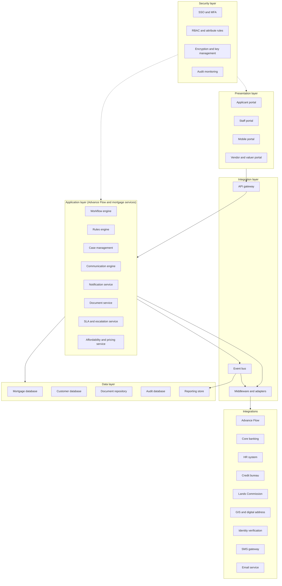
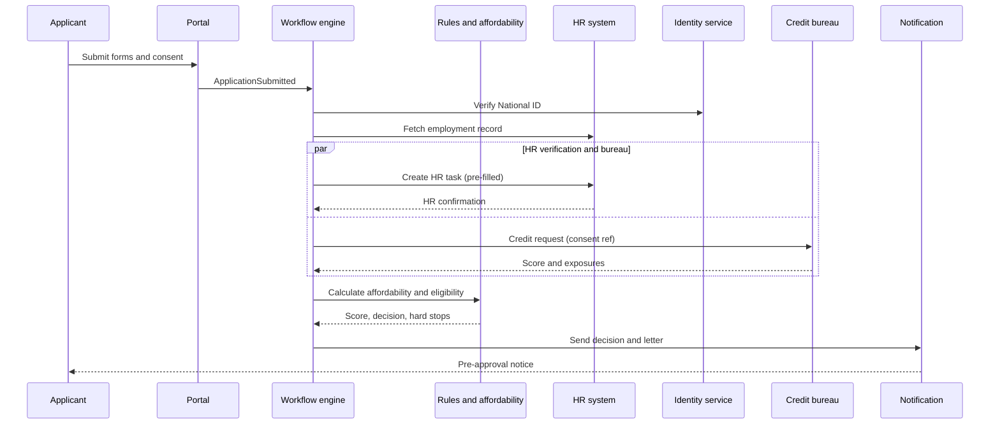

# 17. Integration Architecture and 18. Security Architecture

## 17.1 Layered architecture

## 17.2 Components

| Component | Responsibility | Notes |
|---|---|---|
| Applicant portal | Forms, documents, messages, tracking, e-signature, payments | Responsive web; same codebase serves the mobile portal |
| Staff portal | Task inbox, case workspace, approvals, dashboards | Role-based home |
| Vendor and valuer portal | Restricted views and uploads | Link-based access with MFA |
| Workflow engine | Executes the process definitions in [11](11-process-flows.md) | Advance Flow; BPMN-style definitions where supported |
| Rules engine | Eligibility, routing, limits, SLA selection, document requirements | Decision tables, versioned, testable |
| Case management | Case record, tasks, assignment, conditions, closure | |
| Communication engine | Threads, requests, notes, attachments | |
| Notification service | Templates, channel selection, delivery tracking | Uses SMS and email gateways |
| Document service | Storage, versioning, OCR, classification, retention, search | Object storage with signed URLs |
| SLA and escalation | Clocks, pauses, thresholds, escalation actions | Reads task and calendar data |
| Affordability and pricing | Calculations from [04](04-products-and-journeys.md) | Same code serves portal previews and server-side decisions |
| API gateway | Authentication, throttling, routing, request logging | Single entry for portals and partners |
| Middleware | Adapters per external system, mapping, retries | One adapter per integration |
| Event bus | Publish and subscribe for case events | Drives notifications, reporting, SLA |

## 17.3 Integrations

| System | Direction | Pattern | Data | Trigger | Failure handling |
|---|---|---|---|---|---|
| **Advance Flow** | Both | Native or REST | Process definitions, task state, forms, user directory | Always | Primary platform; outages queue events |
| **Core banking** | Both | REST or message queue | Account validation, mortgage account creation, schedule, payment instruction, payment confirmation | Disbursement, activation | Idempotency key; hold in "pending posting"; reconcile daily |
| **HR system** | In | REST or secured file | Employee status, salary, dates, retirement date, reporting line | Case start, HR task, nightly refresh | Fall back to HR manual confirmation task |
| **Credit bureau** | Both | REST | Request with consent reference; score and exposures | After consent | Retry with backoff; manual upload by Credit |
| **Lands Commission** | Both | Adapter (API if available, otherwise assisted entry) | Search requests and results, registration status | Searches, registration | Legal records result manually with receipt |
| **GIS and digital address** | Out | REST | Address validation, coordinates | Form D, Form E | Accept free-text address with a flag |
| **Identity verification** | Out | REST | National ID check, liveness where available | Form A, co-borrower, vendor | Manual verification task |
| **SMS gateway** | Out | REST | Messages and OTPs | Notifications | Retry, then email |
| **Email service** | Out | SMTP or API | Messages | Notifications | Retry and bounce handling |
| **e-Signature** | Both | Native module or provider | Documents to sign, signed copies, evidence | Consent, offer, mortgage documents | Provider fallback or wet signature with scan |
| **Payment gateway** | In | REST | Fee payments | Valuation fees, registration fees | Manual receipt entry |
| **Valuer portal** | Both | Native | Assignment, report | Valuation | Email-free fallback via Collateral upload |

Each adapter has: timeout, retry with backoff, circuit breaker, idempotency, a mock for testing, monitoring and an assisted-manual fallback (NFR-12, A5).

## 17.4 Key events on the bus

`ApplicationSubmitted`, `ConsentRecorded`, `PreApprovalDecided`, `ValuationRequested`, `ValuationReceived`, `SearchCompleted`, `PropertyDecided`, `ApprovalDecided`, `OfferIssued`, `OfferAccepted`, `ConditionVerified`, `DisbursementApproved`, `FundsReleased`, `AccountActivated`, `PostDisbursementItemDue`, `SLAWarning`, `SLABreach`, `DocumentUploaded`, `MessageSent`.

Subscribers: notification service, SLA service, reporting store, audit writer, workflow engine.

## 17.5 Sequence: submission to pre-approval

## 17.6 Deployment

| Aspect | Design |
|---|---|
| Environments | Development, test, UAT, pre-production, production |
| Hosting | Within the bank's approved hosting arrangements (D6); containers on an orchestrated platform or Advance Flow's hosting |
| Scaling | Stateless services scale horizontally; database with read replicas for reporting |
| Resilience | Two availability zones or sites; automated failover; backups with tested restore |
| Pipeline | Source control, automated build, tests of rules and calculations, security scan, staged promotion |
| Configuration | Environment-specific secrets in a vault |

## 18. Security architecture

### 18.1 Authentication and access

| Control | Design |
|---|---|
| SSO | Staff sign in through the bank's identity provider using OIDC or SAML |
| MFA | Required for all staff roles, for approvers on every decision, and for external users (valuer, vendor) |
| Applicant access | Staff applicants use the same SSO; co-borrowers and vendors use invitation links with one-time codes |
| Session | Idle timeout 15 minutes, absolute 8 hours, device binding for approvers |

### 18.2 RBAC and attribute rules

| Role group | Case scope | Sensitive data |
|---|---|---|
| Applicant | Own case only | Own data |
| HR Officer, Director HR, DMD | Cases at HR tasks | Employment and salary; no bureau detail |
| Mortgage Officer, Team Lead, Head of Mortgage | All cases, subject to ring-fencing | Summary financial data |
| Credit Analyst, Head Credit Evaluation | Cases at credit stages | Full financial and bureau |
| Approvers | Cases assigned to them | Full case |
| Legal | Cases at legal tasks | Property, parties, consent |
| Collateral | Cases at collateral tasks | Property, valuation |
| Valuer, Vendor | Own assignments | Minimum for the task |
| Credit Admin, Operations | Cases at disbursement | Payee and account detail |
| Post Disbursement | Mortgage accounts | Security documents |
| Compliance, Audit | Read-only, all cases | All, with view logging |
| Administrators | Configuration, no case content by default | Break-glass with approval and audit |

**Ring-fencing (P13):** access is denied if the user is the applicant, in their reporting line, a relative on the declared list, or has declared a conflict. The check runs at assignment, at view and at decision time.

**Break-glass:** a time-limited, approved and fully logged access path for support.

### 18.3 Data protection

| Control | Design |
|---|---|
| In transit | TLS 1.2 or higher everywhere, including service to service |
| At rest | Database, object storage and backups encrypted with keys from a key management service; rotation at least yearly |
| Field level | National ID, bank account numbers, vendor bank details encrypted per field; hash column for duplicate lookup |
| Masking | National ID and account numbers masked in lists and logs; full value only where needed |
| Documents | Virus scan on upload, signed short-lived URLs, watermark on download for restricted classes |
| Classification | Public, Internal, Confidential, Restricted; applied per document type and enforced by the document service |
| Privacy | Consent captured and versioned; subject access, correction and retention supported (Act 843; confirm with Compliance) |

### 18.4 Audit and monitoring

| Control | Design |
|---|---|
| What is logged | Logins, case creation, field changes, document actions, views of Restricted data, messages, decisions, configuration changes, exports, privileged access |
| Integrity | Append-only store, hash chain, periodic hash anchoring to a separate system |
| Time | Synchronised clocks, UTC storage |
| Monitoring | Alerts for repeated failed logins, unusual export volumes, access outside hours, approvals from unusual locations, ring-fencing denials |
| Review | Monthly access review, quarterly role recertification, annual penetration test |

### 18.5 Application security

Input validation on server and client; protection against injection, cross-site scripting and request forgery; rate limiting at the gateway; content-type checks on uploads; dependency scanning; secrets in a vault; secure build pipeline; separation of duties between developers and production access.

### 18.6 Fraud and integrity controls specific to mortgages

| Risk | Control |
|---|---|
| Altered salary or payslips | Compare to HR record and OCR values; mismatch flag |
| Same property in multiple applications | Title number uniqueness check |
| Vendor fraud | Due diligence form, bank account name match, cleared status before payment |
| Inflated valuation | Valuer rotation, conflict checks, comparison with price, second review above a threshold |
| Payment diversion | Four-eyes, payee verification, change-of-bank-details control with call-back |
| Insider misuse | Ring-fencing, view logging, segregation of duties |

### 18.7 Business continuity

Backups hourly (database) and daily (documents) with offsite copy; restore tested twice a year; documented manual fallback for each integration; runbooks for incident response; RPO 15 minutes and RTO 4 hours as proposed targets (NFR-02).
