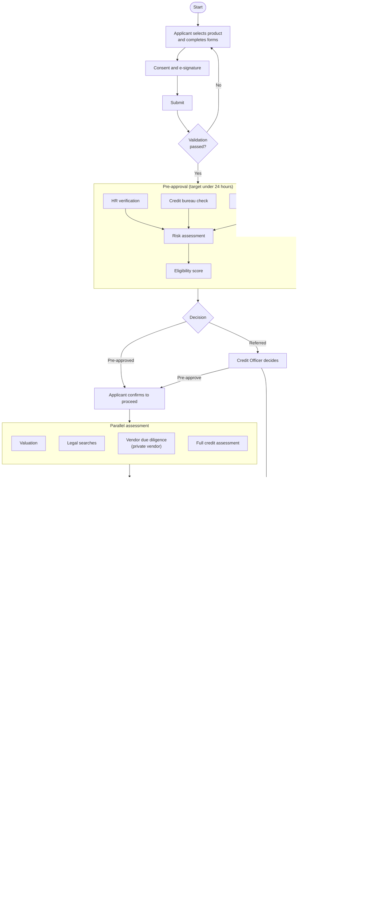
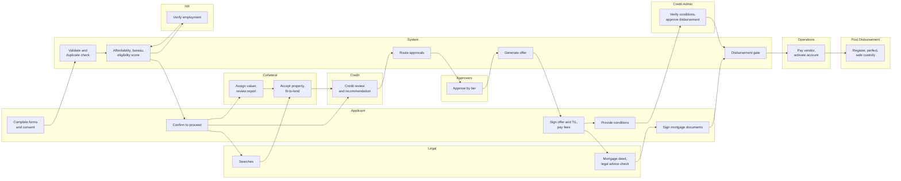
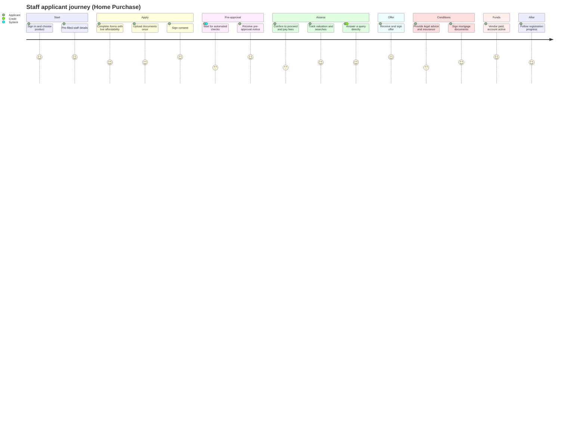
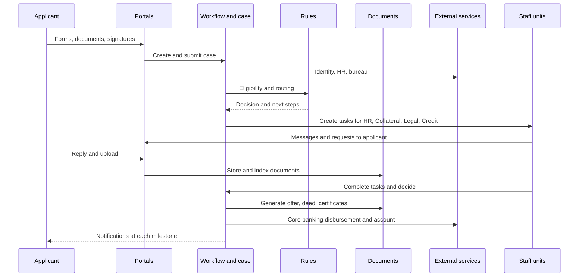
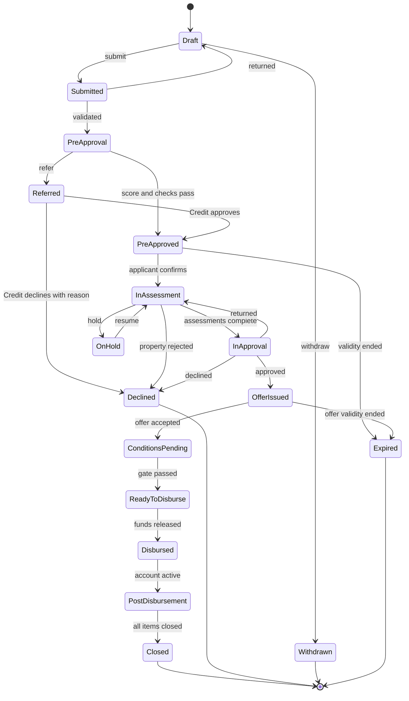
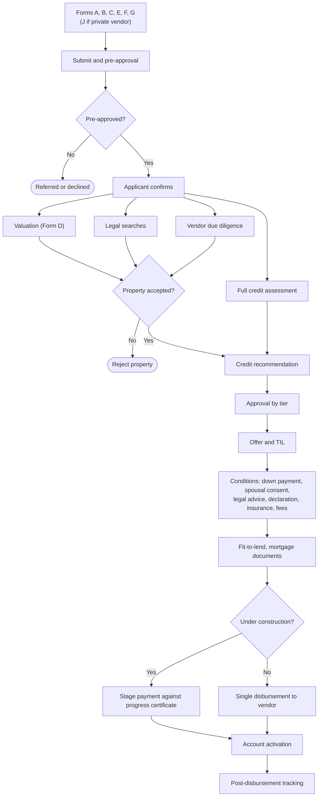
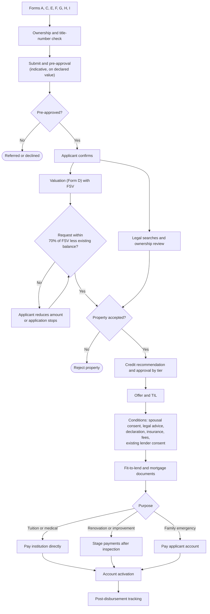

# 20. Future-State Process Flows and 21. Swimlane Diagrams

Seven views. All diagrams are Mermaid.

## 1. End-to-end process flow

## 2. Swimlane diagram (Home Purchase)

## 3. Applicant journey map

| Stage | Applicant sees | Pain removed |
|---|---|---|
| Apply | One guided form, calculators, draft saved | Paper, re-keying |
| Pre-approval | A clear status and the expected time | Silence |
| Assess | Each unit's progress and open requests | Relay through Mortgage Team |
| Offer | One signing session | Four separate hand-offs |
| After | Registration and perfection status | No visibility |

## 4. System interaction diagram

## 5. Mortgage lifecycle diagram

## 6. Home Purchase workflow

## 7. Equity Release workflow

## Mapping to the AS-IS process

| AS-IS step | Where it goes |
|---|---|
| HR chain (Employment Review, HR Approval, Director HR, DMD, No Objection) | HR verification in pre-approval; HR approvals L1 to L3 by tier |
| Review Application, Documents Complete?, Request Missing Documents | Validation and document checklist at submission |
| Prepare Credit Package, Credit Memo | Generated from case data |
| Truth in Lending, Offer Letter | Generated offer pack |
| Affordability, Bureau, Property Assessment, Risk | Pre-approval and credit assessment; property decision moves to Collateral |
| Credit Query, Applicant Response, Reassess | Request for information task between Credit and applicant |
| Four-level approval | Tiered approval matrix |
| Legal searches and deed | Parallel legal track |
| Review Search Reports, Property Acceptable?, Fit-to-Lend | Collateral track |
| Credit Admin verification, Final Pre-Disbursement Verification | One disbursement gate checklist |
| Disburse Funds, Pay Vendor, Activate Account | Operations steps after the gate |
| Registration, Perfection, Lands Commission, Title, Safe Custody | Tracked post-disbursement items |
