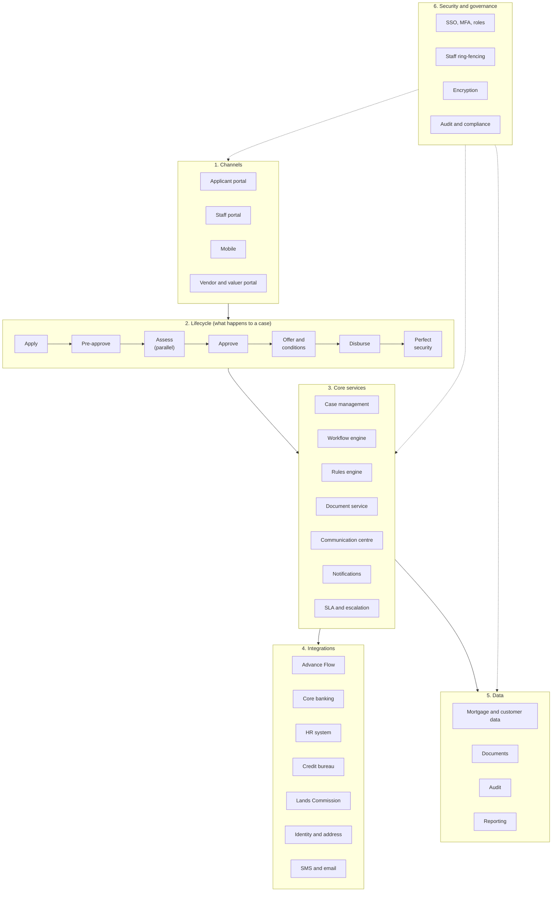

# Framework on a Page: Digital Mortgage Management System

One page that holds the whole design together. Each row points to the document with the detail.

## 1. The framework in one picture

## 2. Two products, one framework

| | Home Purchase Mortgage | Home Equity Release |
|---|---|---|
| Shared | Case, forms engine, documents, communication, approvals, conditions, disbursement, post-disbursement, audit | Same |
| Different forms | A, B, C, D, E, F, G, J (private vendor) | A, C, D, E, F, G, H, I |
| Key rule | Minimum 20% down payment | Maximum 70% of forced sale value |
| Counterparty | Vendor or developer | Optional payee (school, hospital, contractor) |

## 3. The seven lifecycle stages

| # | Stage | What happens | Owner | Exit gate |
|---|---|---|---|---|
| 1 | **Apply** | Smart forms, documents, consent, e-signature | Applicant | Validation passed, consent signed |
| 2 | **Pre-approve** | HR verification, bureau, affordability, risk, score, decision | System, HR, Credit | Decision issued, target under 24 hours |
| 3 | **Assess** (in parallel) | Valuation, legal searches, vendor due diligence, full credit assessment | Collateral, Legal, Credit | Property accepted, recommendation made |
| 4 | **Approve** | Approval by tier, with delegation and escalation | Approval Authorities | All required levels decided |
| 5 | **Offer and conditions** | Offer and Truth in Lending, signing, conditions precedent, fit-to-lend, mortgage documents | Mortgage Team, Legal, Collateral, Applicant | Offer accepted, every mandatory condition verified |
| 6 | **Disburse** | Gate check, disbursement approval, payment, account creation and activation | Credit Admin, Operations | Funds released, account active |
| 7 | **Perfect security** | Registration, perfection, Lands Commission, title perfection, safe custody | Post Disbursement | All items closed |

## 4. The twelve building blocks

| # | Building block | Purpose | Detail |
|---|---|---|---|
| 1 | Digital forms | Ten smart forms with validation and live calculation | [05](05-digital-forms-catalogue.md) |
| 2 | Pre-approval engine | Automated decision in under 24 hours | [04](04-products-and-journeys.md) |
| 3 | Case management | One record per application, tasks, SLA, closure | [06](06-case-workflow-communication.md) |
| 4 | Workflow automation | Nineteen automations from numbering to account activation | [06](06-case-workflow-communication.md) |
| 5 | Rules engine | Eligibility, routing, limits, document requirements | [04](04-products-and-journeys.md), [07](07-approvals.md) |
| 6 | Approval framework | Tiered matrix, limits, escalation, delegation | [07](07-approvals.md) |
| 7 | Document management | Versioned storage, OCR, classification, retention | [03](03-requirements.md), [09](09-data-model-and-schema.md) |
| 8 | Communication centre | Direct applicant-to-unit threads with oversight | [06](06-case-workflow-communication.md) |
| 9 | Valuation and collateral | Valuer assignment, FSV, acceptance, fit-to-lend | [08](08-valuation-collateral-disbursement.md) |
| 10 | Conditions and disbursement | Checklist that blocks early release | [08](08-valuation-collateral-disbursement.md) |
| 11 | Post-disbursement tracking | Owners, due dates, alerts | [08](08-valuation-collateral-disbursement.md) |
| 12 | Dashboards and audit | Role dashboards, immutable audit trail | [12](12-dashboards.md), [10](10-architecture-integration-security.md) |

## 5. Who does what

| Stakeholder | Role in the framework |
|---|---|
| Applicant | Completes forms, signs, answers queries directly, tracks progress |
| HR | Verifies employment; approves by tier |
| Mortgage Team | Owns the product and case oversight; no longer relays messages |
| Credit Team | Assesses affordability and risk; recommends |
| Approval Authorities | Decide within delegated limits |
| Legal Team | Searches, mortgage deed, legal advice checks |
| Collateral Team | Valuation, property acceptance, fit-to-lend, security documents |
| Vendor | Provides property documents through a secure link |
| Credit Administration | Verifies conditions; approves disbursement |
| Operations | Pays, creates and activates the account |
| Post Disbursement | Registration, perfection, title, safe custody |

## 6. Ten rules that govern the framework

1. One case, one record. Nothing lives in email or on paper.
2. Work runs in parallel unless a real dependency says otherwise.
3. The system may pre-approve and refer. It never declines automatically.
4. No bureau check without recorded consent.
5. Valuation and legal searches start only after pre-approval and the applicant's confirmation.
6. Equity release is capped at 70% of forced sale value (less any existing mortgage balance, decision D1).
7. A purchase needs at least a 20% down payment.
8. Nobody works on or approves their own case, a relative's, or a case with a declared conflict.
9. Whoever prepares a recommendation cannot approve it.
10. Disbursement is impossible while any mandatory condition is open.

## 7. Build order

| Phase | Focus |
|---|---|
| 1 | Digital forms and pre-approval |
| 2 | Workflow automation |
| 3 | Case management |
| 4 | Applicant portal |
| 5 | Stakeholder collaboration |
| 6 | Valuation and collateral automation |
| 7 | Analytics and AI |

Phase 0 comes first: measure the current process, confirm Advance Flow's capabilities and settle the open decisions. See [14](14-roadmap-benefits.md).

## 8. Where to find everything

[00 README](00-README.md) lists all 15 documents and the assumptions and open decisions behind them.
