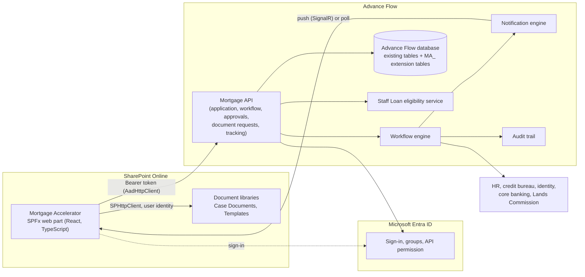

# 1. Solution Architecture

The Mortgage Accelerator is a **module inside the existing Advance Flow LOS**, not a separate application. It is a SharePoint Framework (SPFx) web part, written in React and TypeScript, hosted in SharePoint Online. It signs users in with Microsoft Entra ID, calls Advance Flow APIs for everything transactional, and keeps files in SharePoint document libraries.

## 1.1 What was built, and what is assumed

| Part | Status |
|---|---|
| The 13 modules (pages), domain rules, readiness engine, approval matrix, SLA, gates | **Built and tested** (48 unit and lifecycle tests, a 364-page role sweep, and a browser run of the whole lifecycle) |
| SPFx web part, build configuration, `.sppkg` package | **Built** with the real SPFx 1.18.2 toolchain on Node 18 |
| Advance Flow HTTP client (`HttpAdvanceFlowClient`) and Entra ID token wiring | **Written, not run against a live Advance Flow**. Endpoint paths are the module's contract (see [05](05-api-contract.md)) and must be confirmed against the Advance Flow API reference |
| SharePoint document library store (`SharePointFileStore`) | **Written, not run against SharePoint** |
| Local harness with an in-memory Advance Flow mock | **Built.** It lets the whole module be run and demonstrated without a backend |
| Existing LOS screens | **Seen as two screenshots** (Staff Loan, Loan Eligibility). Everything else about the existing LOS is assumed |

## 1.2 Principles

1. **Reuse before build.** Where Advance Flow already does something (applications, workflow, notifications, document requests, approval routing, tracking, audit), the module calls it. It adds only mortgage-specific behaviour.
2. **One set of policy.** Eligibility numbers come from the existing Staff Loan eligibility service. The module does not run a competing calculation in production.
3. **Files in SharePoint, data in Advance Flow.** Documents live in a document library with metadata and permissions; transactional data lives in the Advance Flow database.
4. **The module is thin.** Business rules that must be identical everywhere (limits, tiers, gates) are pure functions with tests, and the server enforces them again.
5. **Staff privacy.** The applicants are colleagues. Access is by role and by case, with conflict checks.

## 1.3 Architecture



### Why a thin web part

The web part never talks to HR, the bureau or core banking. Those integrations belong to Advance Flow, which already holds the credentials and the audit trail. The module asks Advance Flow for outcomes.

## 1.4 Advance Flow capabilities the module uses

| Advance Flow capability | How the Mortgage Accelerator uses it | Client methods |
|---|---|---|
| **Application Management** | A mortgage case is an Advance Flow application of loan type "MORTGAGE": drafts, submission, locking, ownership, return for correction | `createDraft`, `saveDraft`, `submitCase`, `listCases`, `getCase`, `returnCase`, `withdrawCase` |
| **Workflow Engine** | Runs the Home Purchase and Equity Release process definitions: pre-approval, parallel assessment, approval, conditions, disbursement, post-disbursement. Owns tasks, timers and SLA clocks | `listTasks`, `completeTask`, `confirmProceed`, `acceptOffer` |
| **Notification Engine** | Sends in-app, email and SMS messages from templates; pushes real-time events to the web part | `listNotifications`, `markNotificationRead`, `subscribe` |
| **Document Requests** | "Request a document" from the applicant, with a due date and fulfilment tracking; the file itself goes to SharePoint | `requestDocument`, `listDocRequests`, `uploadDocument` |
| **Approval Routing** | Evaluates the approval matrix, creates approval tasks in parallel groups, handles delegation and escalation | `decideApproval` |
| **Applicant Tracking** | The applicant's status, current stage, SLA clock and next step | `getCase`, `getReadiness` |
| **Audit Trail** | Every action is logged against the case, with actor and time stamp; the module reads it and adds mortgage events | `listAudit` |
| **Staff Loan eligibility** (existing screen) | Account number and OTP, the DIR calculation, Decision Rule and Exceptional Approval | `requestOtp`, `verifyOtp`, `computeEligibility` |

## 1.5 Fit with the existing Staff Loan screens

From the two screenshots of the current LOS:

| Existing LOS | In the Mortgage Accelerator |
|---|---|
| Menu: **Staff Loan → Create Staff Loan, My Loans, Loan Calculator, Collateral Release, Staff Saving Scheme** | A new item, **Mortgage Accelerator**, under Staff Loan opens the web part. "Create Staff Loan" with the mortgage loan types, and "My Loans", link into it |
| Three phases: **Loan Eligibility → Loan Application → Finish** | The wizard uses the same three phases |
| Eligibility: account number (13 digits) and OTP, Loan Type, Date of Birth, Net Salary, Allowances (Rent + Clothing), Loan Amount Requested, Monthly Instalment (Personal + Auto + Education), Monthly Instalment (Mortgage + HP only), "Pay off existing loans?", Compute Eligibility, Reset | Reproduced field for field on the first screen |
| Computation Results: Interest Rate, DIR Limit, Tenor, Periodic Instalment, DIR (Capital + Personal), DIR (All Staff Loans), Loan Amount Qualified For, Decision Rule | Same panel, filled by the eligibility service |
| **Exceptional Approval** checkbox, **Next Step** | Same. Exceptional Approval adds the executive approval level to the case |
| Loan type "MORTGAGE - NEW AQUISITION" | Maps to **Home Purchase**. A second type, **Home Equity Release**, is added |

### Questions for the Advance Flow team

| # | Question | Why it matters |
|---|---|---|
| Q1 | Are the DIR definitions in the screenshot "Capital + Personal" and "All Staff Loans" as assumed in [08](08-business-rules.md)? | The module shows the service's numbers in production, but the local preview uses these definitions |
| Q2 | How does Advance Flow expose eligibility, OTP, applications, tasks and approvals over HTTP (paths, auth, payloads)? | The HTTP client uses the contract in [05](05-api-contract.md); an adapter maps any difference |
| Q3 | Does the existing **Collateral Release** menu item already cover equity release? | Home Equity Release may overlap with it, and the two should share data rather than duplicate it |
| Q4 | Does Advance Flow already expose a push channel (SignalR or webhooks) for notifications? | The client polls every 15 seconds as a fallback |
| Q5 | Is the Advance Flow web app embedding or linking to SharePoint pages today? | Decides whether the module opens in a new tab or inside a frame |

## 1.6 Module catalogue

| # | Module | Pages and entry points | Source |
|---|---|---|---|
| 1 | Home Purchase Mortgage | `#/purchase` product page, `#/apply/purchase` | `pages/ProductPages.tsx` |
| 2 | Home Equity Release Mortgage | `#/equity`, `#/apply/equity` | `pages/ProductPages.tsx` |
| 3 | Mortgage Application Wizard | `#/apply/...` three phases | `pages/WizardPage.tsx`, `EligibilityPhase.tsx` |
| 4 | Mortgage Readiness Engine | `#/readiness`, live panel in the wizard, tab in the case | `domain/rules.ts` `evaluateReadiness`, `pages/ReadinessPage.tsx` |
| 5 | Mortgage Case Management | `#/cases`, `#/cases/:id` with 10 tabs | `pages/CasesPage.tsx`, `CaseWorkspace.tsx` |
| 6 | Stakeholder Collaboration Hub | `#/hub` | `pages/HubPage.tsx`, `ThreadView` |
| 7 | Valuation Management | `#/valuations` | `pages/CollateralPages.tsx` |
| 8 | Property Repository | `#/properties` | `pages/PropertiesPage.tsx` |
| 9 | Fit-To-Lend Workspace | `#/fit-to-lend/:caseId` | `pages/CollateralPages.tsx` |
| 10 | Conditions Tracker | `#/conditions` | `pages/AfterApprovalPages.tsx` |
| 11 | Mortgage Dashboard | `#/dashboard` | `pages/DashboardPage.tsx` |
| 12 | Executive Dashboard | `#/executive` | `pages/InsightPages.tsx` |
| 13 | Mortgage Analytics | `#/analytics` | `pages/InsightPages.tsx` |
| (supporting) | Disbursement, Post-disbursement, Audit trail | `#/disbursement`, `#/post-disbursement`, `#/audit` | `AfterApprovalPages.tsx`, `InsightPages.tsx` |

## 1.7 Code layout

```
mortgage-accelerator/spfx/
  src/webparts/mortgageAccelerator/   SPFx web part, manifest, strings
  src/app/
    App.tsx, nav.ts, context.tsx      shell, role-aware navigation, routing, data hooks
    domain/                           types, rules (pure, tested), document specs
    services/                         client.ts (contract), httpClient.ts (production),
                                      mockClient.ts + seed.ts (harness), fileStore.ts,
                                      sharePointFileStore.ts
    components/                       ui, panels, charts
    pages/                            one file per module group
  harness/                            local preview (not packaged)
  config/                             SPFx build configuration
```

The same `MortgageApp` component runs in the web part and in the harness. Only the `client` and `files` objects differ.

## 1.8 Build, package, deploy

| Step | Command or action |
|---|---|
| Install | `npm install` in `mortgage-accelerator/spfx` (Node 18.17 or later 18.x for SPFx 1.18) |
| Test | `npm test` (48 tests) and `npm run typecheck` |
| Preview locally | `npm run harness`, then open `dist/index.html` |
| Package | `npm run package` produces `sharepoint/solution/mortgage-accelerator.sppkg` |
| Entra ID | Register the Advance Flow API (App ID URI), expose the scope `Mortgage.ReadWrite`; set the `webApiPermissionRequests` resource in `config/package-solution.json` to its name; a tenant admin approves the request in the SharePoint admin centre |
| Deploy | Upload the `.sppkg` to the tenant app catalog, add the app to the site |
| Libraries | Create the `Case Documents` library with the columns in [02](02-data-model.md) |
| Page | Create a **Single-part app** page, add the web part, set the API address and resource in its properties |
| Menu | Add the page link under **Staff Loan** in Advance Flow |
