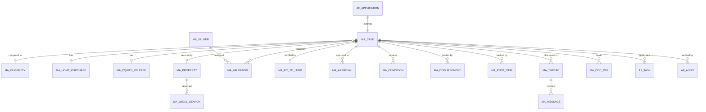

# 2. Data Model

Two stores, split by what each is good at.

| Store | Holds | Why |
|---|---|---|
| **Existing Advance Flow database** | Cases, forms, eligibility, tasks, approvals, conditions, valuations, searches, disbursements, post-disbursement items, threads, audit | Transactional, relational, already backed up, secured and audited |
| **SharePoint Online document libraries** | The files: forms, IDs, payslips, valuation reports, deeds, certificates | Versioning, metadata, search, retention labels, permissions, and the bank already runs it |

Advance Flow stores only a **reference** to each file (library URL, version, metadata). Bytes never pass through the mortgage API.

## 2.1 Entities (extension tables in the Advance Flow database)

The module adds `MA_`-prefixed tables next to Advance Flow's own, keyed by the existing application id. The full logical model and PostgreSQL schema are in [the future-state design, document 09](../../docs/future-state/09-data-model-and-schema.md). Differences for this module:

| Topic | Future-state design | This module |
|---|---|---|
| Applicant | Own `applicant` table | Reads the staff record from Advance Flow and HR; no copy beyond a snapshot on the case |
| Case root | `mortgage_application` | `MA_Case`, one row per Advance Flow application of a mortgage loan type, `application_id` is a foreign key to Advance Flow's application table |
| Eligibility | Part of the pre-approval | New `MA_Eligibility`: the inputs and outputs of the Staff Loan eligibility step |
| Documents | Blob storage | Reference rows pointing to SharePoint |
| Audit | Own table | Advance Flow's audit trail, with mortgage event types |
| Notifications | Own table | Advance Flow's notification engine |



## 2.2 Tables

| Table | Key columns | Notes |
|---|---|---|
| `MA_Case` | `application_id` PK/FK, `product` (`HOME_PURCHASE`, `EQUITY_RELEASE`), `state`, `reference`, `currency`, `amount_requested`, `approved_amount`, `tenor_years`, `rate_pct`, `owner_user_id`, `stage_entered_at`, `sla_code`, `sla_due_at`, `sla_paused_since`, `sla_paused_minutes`, `locked`, `returned_note`, `returned_from_state`, `decline_reason`, `form_versions` | One row per case. Unique index on (employee, product) where state is active (BR-01) |
| `MA_Eligibility` | `application_id` PK/FK, `input_json`, `result_json`, `exceptional_approval`, `computed_at`, `service_version` | Stores exactly what the eligibility service returned |
| `MA_HomePurchase` | `application_id`, `purchase_price`, `property_value`, `down_payment`, `vendor_type`, `vendor_name`, `construction_status` | Check: down payment at least 20% of price |
| `MA_EquityRelease` | `application_id`, `declared_value`, `forced_sale_value`, `existing_balance`, `existing_status`, `ownership`, `purpose`, `use_of_funds_json` | Release cap enforced by trigger (BR-03) |
| `MA_Property` | `property_id`, `title_number` (unique among active cases), `address`, `digital_address`, `registered_owner`, `ownership_type`, `encumbrance`, `region` | Kept across cases |
| `MA_LegalSearch` | `search_id`, `property_id`, `type` (`LAND`, `CERTIFICATE`, `CONSOLIDATED`), `status`, `result`, `notes`, `report_doc_id` | |
| `MA_Valuer` | `valuer_id`, `firm`, `registration_no`, `areas`, `max_jobs` | The panel |
| `MA_Valuation` | `valuation_id`, `application_id`, `property_id`, `valuer_id`, `status`, `due_at`, `market_value`, `forced_sale_value`, `valuation_date`, `condition`, `occupancy`, `reviewed_by`, `review_outcome` | `forced_sale_value <= market_value` |
| `MA_FitToLend` | `application_id`, `decision`, `reason`, `checklist_json`, `certificate_no`, `issued_at`, `valid_until` | Certificate only if preconditions pass (BR-07) |
| `MA_Approval` | `approval_id`, `application_id`, `level`, `group_no`, `approver_id`, `on_behalf_of`, `decision`, `comment`, `assigned_at`, `due_at`, `decided_at`, `matrix_version` | Created by Advance Flow's approval routing |
| `MA_Condition` | `condition_id`, `application_id`, `code`, `mandatory`, `owner_role`, `verifier_role`, `due_date`, `status`, `evidence_doc_id`, `verified_by`, `waived_by`, `waiver_reason` | Disbursement is blocked while a mandatory row is not `VERIFIED` or `WAIVED` |
| `MA_Disbursement` | `disbursement_id`, `application_id`, `tranche_no`, `payee`, `account_enc`, `amount`, `status`, `requested_by`, `approved_by`, `paid_at`, `payment_ref` | Check: approver differs from requester; sum of tranches at most approved amount |
| `MA_PostItem` | `item_id`, `application_id`, `type`, `owner`, `due_date`, `status`, `completed_at` | Five types, alerts by ageing |
| `MA_Thread`, `MA_Message` | thread: `application_id`, `topic`, `visible_to_applicant`, `oversight_joined`; message: `kind` (`MESSAGE`, `REQUEST`, `NOTE`, `SYSTEM`), `body`, `due_date`, `closed`, `attachments` | Append-only |
| `MA_DocRef` | `doc_id`, `application_id`, `category`, `doc_type`, `library_url`, `version`, `classification`, `uploaded_by`, `uploaded_at`, `sha256` | Reference to SharePoint |
| `MA_Config` | `key`, `value_json`, `effective_from`, `effective_to`, `changed_by` | Limits, rates, SLAs, matrix, templates with version history |

Sensitive columns (National ID, account numbers) are encrypted per field, with a hash column for duplicate lookup.

## 2.3 Delta DDL (PostgreSQL syntax; adapt to the Advance Flow database engine)

```sql
CREATE TABLE ma_case (
  application_id     BIGINT PRIMARY KEY REFERENCES af_application(id),
  product            TEXT NOT NULL CHECK (product IN ('HOME_PURCHASE','EQUITY_RELEASE')),
  state              TEXT NOT NULL,
  reference          TEXT UNIQUE,
  currency           CHAR(3) NOT NULL DEFAULT 'GHS',
  amount_requested   NUMERIC(18,2),
  approved_amount    NUMERIC(18,2),
  tenor_years        INT,
  rate_pct           NUMERIC(6,3),
  owner_user_id      TEXT,
  stage_entered_at   TIMESTAMPTZ NOT NULL DEFAULT now(),
  sla_code           TEXT,
  sla_due_at         TIMESTAMPTZ,
  sla_paused_since   TIMESTAMPTZ,
  sla_paused_minutes INT NOT NULL DEFAULT 0,
  locked             BOOLEAN NOT NULL DEFAULT FALSE,
  returned_note      TEXT,
  returned_from_state TEXT,
  decline_reason     TEXT
);

CREATE TABLE ma_eligibility (
  application_id        BIGINT PRIMARY KEY REFERENCES ma_case(application_id),
  input_json            JSONB NOT NULL,
  result_json           JSONB NOT NULL,
  exceptional_approval  BOOLEAN NOT NULL DEFAULT FALSE,
  computed_at           TIMESTAMPTZ NOT NULL DEFAULT now(),
  service_version       TEXT
);

CREATE TABLE ma_doc_ref (
  doc_id          BIGSERIAL PRIMARY KEY,
  application_id  BIGINT NOT NULL REFERENCES ma_case(application_id),
  category        TEXT NOT NULL,
  doc_type        TEXT NOT NULL,
  library_url     TEXT NOT NULL,
  version         INT NOT NULL DEFAULT 1,
  classification  TEXT NOT NULL CHECK (classification IN ('INTERNAL','CONFIDENTIAL','RESTRICTED')),
  uploaded_by     TEXT NOT NULL,
  uploaded_at     TIMESTAMPTZ NOT NULL DEFAULT now(),
  sha256          TEXT
);

CREATE TABLE ma_disbursement (
  disbursement_id BIGSERIAL PRIMARY KEY,
  application_id  BIGINT NOT NULL REFERENCES ma_case(application_id),
  tranche_no      INT NOT NULL,
  payee           TEXT NOT NULL,
  account_enc     BYTEA NOT NULL,
  amount          NUMERIC(18,2) NOT NULL CHECK (amount > 0),
  status          TEXT NOT NULL,
  requested_by    TEXT NOT NULL,
  approved_by     TEXT,
  paid_at         TIMESTAMPTZ,
  payment_ref     TEXT,
  UNIQUE (application_id, tranche_no),
  CHECK (approved_by IS NULL OR approved_by <> requested_by)
);
-- The remaining ma_ tables follow the columns in section 2.2 and the constraints in
-- docs/future-state/09-data-model-and-schema.md (valuation, search, condition, post item, thread, message).
```

## 2.4 SharePoint document libraries

### Library `Case Documents`

| Setting | Value |
|---|---|
| Structure | One folder per case reference, for example `Case Documents/MTG-2026-001014/` |
| File name | `<doctype>-<original name>`; versions are kept by SharePoint versioning (major versions, 50 kept) |
| Columns | `CaseRef` (text, indexed), `DocType` (choice), `Category` (choice), `Classification` (choice: Internal, Confidential, Restricted), `UploadedByRole` (text), `Verified` (yes/no) |
| Content types | Application Form, Identity, Income, Property, Credit, Legal, Collateral, Insurance, Registration, Disbursement |
| Retention | Retention labels per category, set from the bank's policy (decision D6); title documents for the life of the loan plus perfection |
| Sensitivity | Sensitivity labels Confidential and Restricted; Restricted blocks download outside managed devices |
| Search | Managed properties on `CaseRef`, `DocType`, `Classification` |

### Other libraries

| Library | Purpose |
|---|---|
| `Mortgage Templates` | Offer letter, Truth in Lending, mortgage deed, fit-to-lend certificate, consent text; versioned, with an approval workflow |
| `Valuation Reports` | Restricted; the valuer uploads through the module, not directly |

### Permissions

Each case folder breaks inheritance and grants only: the applicant (contribute to their own folder), the owner team groups for stages the case has reached, and Compliance (read). The module sets this when the case is submitted and updates it at stage changes. Ring-fenced users (colleagues in the applicant's reporting line) are removed. See [06](06-permissions-model.md).

## 2.5 What the harness does instead

The local harness keeps the same shapes in memory (`services/seed.ts`, `services/mockClient.ts`) and uses a `MockFileStore` that records the library path without storing bytes. Data resets on reload.
