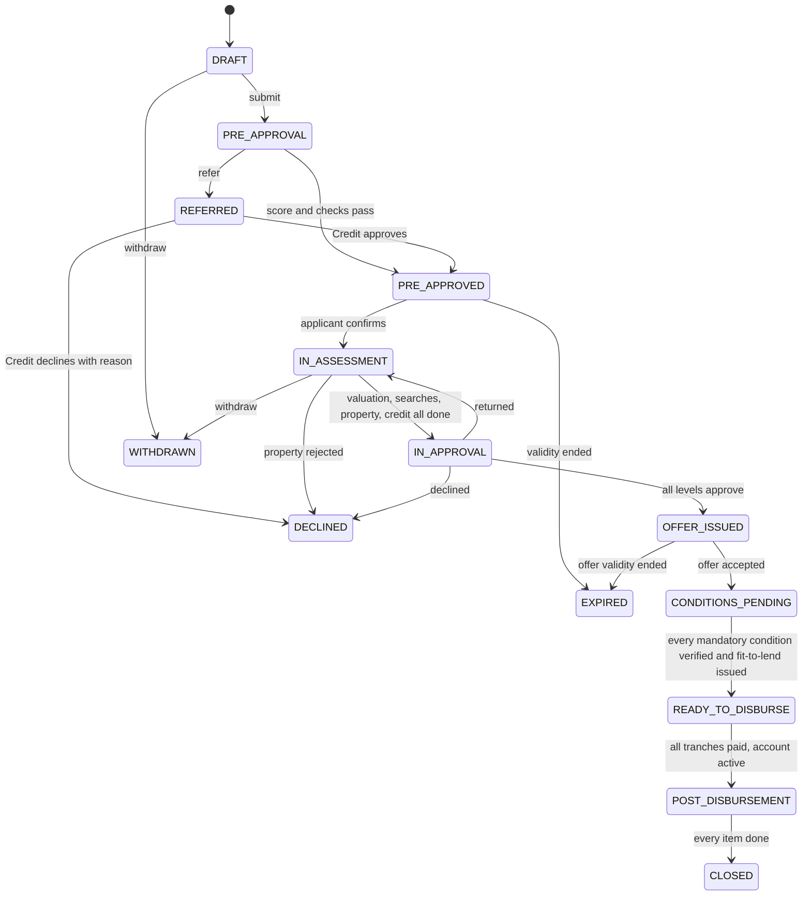
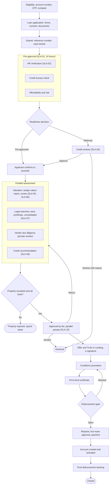
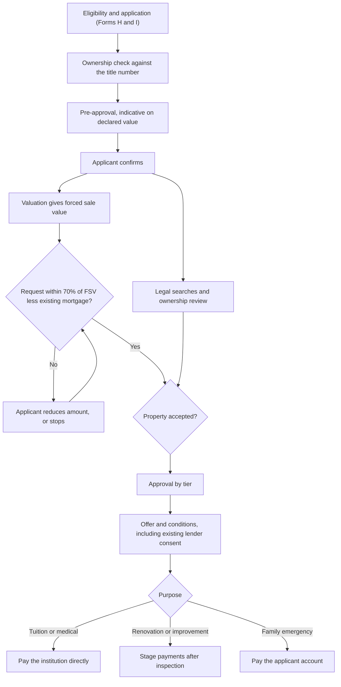

# 3. Workflow Architecture

Two process definitions run on the Advance Flow **Workflow Engine**: `HomePurchaseMortgage` and `EquityReleaseMortgage`. They share most steps. The module does not execute workflow itself; it starts instances, shows tasks, completes user tasks and reflects state. The mock client in the harness reproduces the same transitions so the module can be demonstrated and tested.

## 3.1 Case states

A submitted case can be **returned for correction**. The case is unlocked, the state it was in is remembered, and resubmission resumes there.

## 3.2 Home Purchase process

Under-construction purchases repeat "Request, approval, payment" per stage against a progress certificate.

## 3.3 Equity Release process

Same skeleton, with these differences.

## 3.3a After the mortgage: settlement and Collateral Release

When the loan is fully repaid, the existing **Collateral Release** request releases the security and the title documents held in safe custody. The module links the mortgage case to that request by loan number and shows its status; it does not run a second release process. The case's *safe custody* item is the record of what is being held until then.

## 3.4 Tasks, owners and SLA

SLA values are **proposed** (decision D3). Clocks pause while a request to the applicant is open.

| Task | Owner | SLA code | Target |
|---|---|---|---|
| Pre-approval decision | System | SLA-01 | 24 hours |
| Verify employment and salary | HR | SLA-02 | 4 business hours |
| Credit review of a referral | Credit | SLA-04 | 1 business day |
| Assign valuer | Collateral | SLA-05 | 1 business day |
| Valuation report | Valuer | SLA-06 | 5 business days |
| Legal searches | Legal | SLA-07 | 5 business days |
| Property acceptance | Collateral | SLA-08 | 2 business days |
| Credit recommendation | Credit | SLA-09 | 2 business days |
| Each approval level | Approvers | SLA-10 | 1 business day |
| Fit-to-lend | Collateral | SLA-12 | 1 business day |
| Disbursement verification and approval | Credit Admin | SLA-13 | 2 business days |
| Applicant response to a request | Applicant | SLA-15 | 5 business days |

Escalation: warning at 75% of target, breach at 100% (supervisor), unit head at 150%. The module shows these as chips on cases and tasks; Advance Flow sends the notifications.

## 3.5 Parallelism and gates

| Gate | Rule | Enforced in |
|---|---|---|
| Enter assessment | Applicant confirmation after pre-approval (BR-06) | Workflow |
| Enter approval | Valuation accepted, all three searches complete and not adverse, property accepted, credit recommendation done | `fitToLendBlockers` plus workflow |
| Fit-to-lend | Accepted valuation, clear searches, accepted property, complete checklist; equity release within 70% of FSV (BR-07, BR-03) | `fitToLendBlockers` |
| Disbursement | Offer accepted, every mandatory condition verified or waived, certificate valid (BR-10) | `disbursementBlockers` |
| Payment | A different person approves than requested (four-eyes) | `MA_Disbursement` check, service |
| Amount | Total disbursed at most approved amount | `remainingToDisburse`, trigger |

## 3.6 Approval routing

Advance Flow's approval routing evaluates the matrix (tier by amount, an extra executive level for policy exceptions, **including Exceptional Approval from the eligibility step**). Levels in the same group run in parallel; the next group opens when the current one is complete. See [08](08-business-rules.md) for the tier table.

## 3.7 Events, notifications and real-time updates

| Event | Raised by | Recipients | Channels |
|---|---|---|---|
| Application submitted | Workflow | Applicant (with reference), Mortgage Team | In-app, email, SMS |
| Pre-approval decided | Workflow | Applicant, Credit if referred | In-app, email, SMS |
| Request for information | Collaboration hub | Recipient | In-app, email |
| Assessment started | Workflow | Collateral, Legal, Credit | In-app |
| Adverse search, property rejected | Legal, Collateral | Applicant, Credit, Mortgage Team | In-app, email, SMS |
| Approval required | Workflow | Approver | In-app, email |
| Offer ready to sign | Workflow | Applicant | In-app, email, SMS |
| Ready to disburse | Workflow | Credit Admin | In-app |
| Funds released | Operations | Applicant | In-app, email, SMS |
| Post-disbursement item overdue | Scheduler | Owner, supervisor | In-app, email |
| SLA warning, breach | Scheduler | Owner, supervisor | In-app, email |

The web part subscribes through `client.subscribe`. The production client polls `/notifications?since=` every 15 seconds; if Advance Flow offers SignalR, a SignalR-backed `subscribe` replaces the polling without any page change. Each notification shows a toast and increments the bell; opening it goes to the case.

Submission wording is fixed: "Your mortgage application has been submitted successfully. Reference Number: {reference}. You will receive updates as your application progresses." and, to the team, "A new mortgage application has been submitted and requires review."

## 3.8 Audit logging

Every client action maps to an audit event written by Advance Flow with actor, time stamp and case: application created, eligibility computed, form submitted, workflow initiated, documents uploaded, requests sent and closed, status changes, valuations, searches, property decisions, approval decisions, offer accepted, conditions, certificate issued, disbursement requested, approved and released, post-disbursement updates, notifications sent, returns and withdrawals. The harness test checks that a full lifecycle leaves each of these entries.
