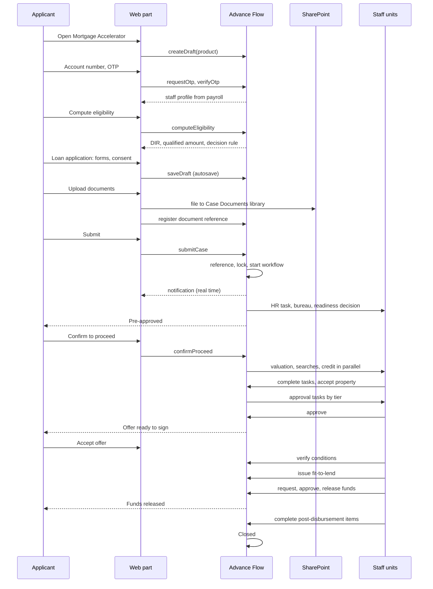
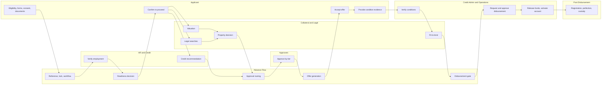

# 9. End-to-End Lifecycle

One lifecycle for both products. The steps below are the ones the browser test runs from start to finish: Yaa applies for a Home Purchase mortgage, and Collateral, Legal, Credit, an Approver, Credit Administration, Operations and Post Disbursement each act in turn. The case ends **Closed** with 155 audit entries.

## 9.1 Sequence

## 9.2 Stage by stage

| # | State | What happens | Owner | Exit gate | Clock |
|---|---|---|---|---|---|
| 1 | Draft | Eligibility (account number, OTP, compute); application forms, consent, documents; autosave | Applicant | Submit passes validation, no hard stop, all required documents | None |
| 2 | Pre-approval | Reference number, case locked, HR verification, bureau, affordability, risk, score | System, HR | Readiness decision | SLA-01, 24 hours |
| 2a | Referred | A Credit officer decides | Credit | Pre-approve or decline with reason | SLA-04 |
| 3 | Pre-approved | Applicant confirms to proceed | Applicant | Confirmation (BR-06) | Validity 90 or 60 days |
| 4 | In assessment | **Parallel:** valuation, three legal searches, vendor due diligence, credit recommendation, property decision | Collateral, Legal, Credit | Valuation accepted, searches clear, property accepted, credit done | SLA-05 to SLA-09 |
| 5 | In approval | Approval groups in sequence, levels in a group in parallel | Approvers | All levels approve | SLA-10 per level |
| 6 | Offer issued | Offer and Truth in Lending generated; applicant signs; conditions created | System, Applicant | Offer accepted | Offer validity |
| 7 | Conditions pending | Evidence submitted and verified; fit-to-lend certificate issued | Applicant, Legal, Collateral, Credit Admin | Every mandatory condition verified or waived, certificate valid (BR-10) | Per condition |
| 8 | Ready to disburse | Credit Admin requests disbursement; a different person approves; Operations releases funds | Credit Admin, Operations | Tranches total the approved amount | SLA-13 |
| 9 | Post-disbursement | Account created and activated; registration, perfection, Lands Commission, title perfection, safe custody tracked | Post Disbursement | Every item done or waived | Due dates 30 to 130 days |
| 10 | Closed | Closure summary | System | | |

After closure, when the loan is repaid, the existing **Collateral Release** request releases the security and the documents in safe custody (see [01, section 1.5a](01-solution-architecture.md)).

Exits at any point: **Declined** (Credit, an approver, or a rejected property), **Withdrawn**, **Expired**, **On hold**.

## 9.3 The two products side by side

| Step | Home Purchase | Home Equity Release |
|---|---|---|
| Eligibility loan type | MORTGAGE - NEW ACQUISITION | MORTGAGE - HOME EQUITY RELEASE |
| Forms | Applicant, request, finances, consent, documents; vendor due diligence if private | Applicant, equity release (value, ownership, existing mortgage, purpose, use of funds), finances, consent, documents |
| Pre-approval collateral check | Down payment at least 20%, loan within 80% | Indicative maximum on the declared value; ownership checked |
| Valuation | Confirms value; checked against price | Gives the forced sale value; the 70% cap is re-applied and the applicant can reduce the amount |
| Conditions | Includes down payment proof, vendor cleared | Includes existing lender consent when another lender holds a charge |
| Payee | Vendor or developer; stage payments if under construction | By purpose: institution direct, contractor in stages, or applicant |

## 9.4 Swimlane

## 9.5 What was verified

| Check | Result |
|---|---|
| Business rules and eligibility maths | 35 unit tests, all passing |
| Lifecycle in the mock client: every gate, four-eyes, locks, returns, rejections, SLA pause and resume, real-time events, OTP | 13 tests, all passing |
| Every page for every role | 364 page loads, no error |
| The whole lifecycle through the browser, by each role in turn | Draft to Closed, no console errors |
| SPFx production bundle and `.sppkg` | Built with the real SPFx 1.18.2 toolchain on Node 18 |
| Against a live Advance Flow, SharePoint and Entra ID | **Not done.** That needs the tenant and the API reference |
